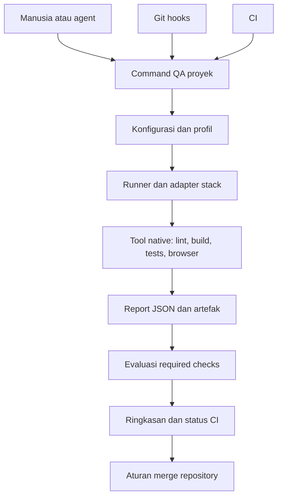

# Rencana QA Toolkit Lintas Proyek dan Agent

Tanggal: 14 Oktober 2026

Status: **Proposal untuk ditinjau; belum merupakan implementasi**

Cakupan: seluruh proyek pengguna, tidak terbatas pada `k-posin` atau Gas Town

Pelacakan pekerjaan dokumen: `gt-ersg`

## 1. Ringkasan keputusan

Bangun standar QA pribadi yang portabel: command konsisten, konfigurasi per proyek, hasil terstruktur, skill agent terpilih, dan guards pada Git serta CI. Agent membantu eksplorasi dan diagnosis; pemeriksaan kelulusan dijalankan secara deterministik oleh tool pengujian.

Rekomendasi implementasi dimulai dengan **dua proyek pilot berbeda stack**, memakai command native yang sudah ada. Setelah kontrak command dan format laporan terbukti, ekstrak runner bersama yang tipis. Pendekatan ini menghindari membuat framework besar sebelum mengetahui variasi nyata antarproyek.

Target pengalaman pengguna:

1. Pindahkan atau unduh paket ke mesin baru.
2. Jalankan setup untuk komponen yang dipilih.
3. Inisialisasi konfigurasi suatu repository, tinjau hasil deteksi, lalu aktifkan.
4. Jalankan QA melalui antarmuka yang sama dari terminal, agent, dan CI.
5. Dapatkan keputusan kelulusan dengan bukti yang sesuai revision yang diuji.

Nama command `qa` dalam dokumen ini masih konseptual. Perlu memeriksa benturan executable sebelum menetapkannya.

## 2. Kondisi awal

Koleksi sumber sudah tersedia di `/Users/maskapai/masesas/AI/qa`, sekitar 1,5 GB:

- 20 shallow Git clones dan arsip sumber per commit.
- 7 skill pilihan: `systematic-debugging`, `verification-before-completion`, `test-driven-development`, `playwright-best-practices`, `playwright-cli`, `webapp-testing`, dan `agent-browser`.
- 8 snapshot dokumentasi resmi.
- Manifest URL/commit, lisensi upstream, panduan rules/hooks, proposal command, serta checksum.
- Verifikasi sebelumnya memeriksa 39.883 file tanpa kegagalan checksum.

Angka tersebut menggambarkan snapshot koleksi saat dibuat; perubahan setelahnya perlu diverifikasi ulang. `verify.py` dalam koleksi hanya memeriksa integritas koleksi, **bukan runner QA proyek**.

Belum tersedia installer terpadu, runner `qa`, guards aktif, atau integrasi CI/agent siap pakai. Dependency, browser binaries, dan toolchain target belum dipasang oleh proses pengumpulan. Kumpulan source juga bukan paket executable offline lengkap.

## 3. Tujuan dan batas cakupan

### Tujuan

- Mengurangi waktu agent/manusia mencari cara build dan test pada setiap repository.
- Menemukan kegagalan lebih awal dengan biaya pemeriksaan yang proporsional.
- Mengubah bug hasil eksplorasi menjadi regresi yang dapat diulang.
- Menyamakan cara memverifikasi pekerjaan antara manusia, agent, dan CI.
- Memisahkan kegagalan produk, kegagalan lingkungan, serta pekerjaan yang belum diuji.
- Memudahkan perpindahan mesin dan penambahan stack tanpa menduplikasi seluruh toolkit.

### Di luar versi pertama

- Menggantikan seluruh test framework proyek.
- Menjamin aplikasi bebas bug atau mengklaim peningkatan produktivitas tanpa pengukuran.
- Menentukan sendiri aturan bisnis hanya dari implementasi saat ini.
- Menjalankan seluruh pemeriksaan berat setelah setiap edit.
- Membangun orkestrator multi-agent baru di atas Gas Town.
- Membuat dukungan penuh semua OS, bahasa, dan runtime agent sekaligus.
- Membuat layanan SaaS, dashboard pusat, atau sistem pembelajaran otomatis.

## 4. Prinsip arsitektur

1. **Command proyek adalah sumber kebenaran.** Gunakan package scripts, Make, Gradle, atau runner native yang sudah dipelihara.
2. **Runner tidak membutuhkan LLM.** Model memilih strategi dan menganalisis temuan; hasil check ditentukan proses yang dapat diulang.
3. **Kontrak bersama, adapter per stack.** Jangan mengasumsikan setiap proyek merupakan aplikasi Node/web.
4. **Evidence terikat input.** Commit saja tidak cukup ketika worktree masih berubah.
5. **Required checks gagal secara tertutup.** Check wajib yang tidak selesai tidak menghasilkan status lulus.
6. **Agent hooks memberi umpan balik; CI menegakkan merge.** Rules dan hooks lokal bukan batas keamanan yang tidak dapat dilewati.
7. **Adopsi bertahap dan reversibel.** Setup harus menampilkan perubahan dan menyediakan cara melepas integrasi yang dikelolanya.
8. **Instalasi eksplisit.** Menjalankan tes tidak diam-diam memasang dependency atau mengubah konfigurasi global.



## 5. Alternatif dan rekomendasi

| Opsi | Kelebihan | Biaya/batas | Keputusan |
| --- | --- | --- | --- |
| Native scripts per proyek | Cepat, sedikit dependency, sesuai kebiasaan stack | Format command/report mudah berbeda | Gunakan pada pilot |
| Runner tipis dengan konfigurasi | Antarmuka, status, dan report konsisten | Membutuhkan lifecycle dan pengujian runner | Ekstrak setelah pilot |
| Framework QA/agent menyeluruh | Banyak workflow tersedia sekaligus | Potensi duplikasi orkestrasi dan perubahan workflow besar | Eksperimen terpisah |

Bahasa implementasi runner belum diputuskan. Python menarik untuk prototipe adapter dan JSON/report; Go menarik untuk distribusi binary mandiri lintas mesin. Pilih setelah mengetahui OS target, runtime yang tersedia, dan biaya distribusi. Jangan memulai dengan dua implementasi sekaligus.

## 6. Susunan paket yang diusulkan

```text
qa-toolkit/
  bin/                     # Entry point; nama executable diputuskan saat pilot
  installer/               # Setup, upgrade, uninstall, pemeriksaan prerequisite
  adapters/                # Adapter stack dan normalisasi report
  policies/                # Profil, aturan required/optional, aturan evidence
  integrations/
    git/                   # Lefthook dan integrasi hook existing
    ci/                    # Template CI provider yang dipilih
    agents/                # Adapter runtime agent yang tervalidasi
  templates/               # Konfigurasi awal repository
  skills/                  # Skill pilihan dan provenance
  tests/                   # Pengujian runner dan fixture repository
  docs/                    # Setup, troubleshooting, migration
  sources/                 # Koleksi upstream; opsional pada distribusi runtime
  manifest.json            # Versi sumber/tool yang dikurasi
```

Konfigurasi proyek diusulkan memakai `.qa/config.json`, sedangkan output berada di `.qa/runs/<run-id>/`. Format JSON dipilih sebagai kandidat awal karena mudah divalidasi dan dibaca lintas runtime. Lokasi final harus memeriksa benturan dengan struktur repository existing.

Pisahkan distribusi **runtime ringkas** dari **koleksi sumber lengkap**. Pengguna tidak perlu menyalin 1,5 GB untuk menjalankan lint dan unit test pada setiap mesin. Paket lengkap tetap berguna untuk referensi, lisensi, audit, dan pengembangan toolkit.

## 7. Kurasi komponen

| Komponen | Fungsi | Profil/pemakaian |
| --- | --- | --- |
| Superpowers: systematic-debugging | Investigasi penyebab sebelum patch | Inti agent lintas proyek |
| Superpowers: verification-before-completion | Klaim selesai berdasarkan bukti | Inti agent lintas proyek |
| Superpowers: test-driven-development | Tes perilaku untuk perubahan yang relevan | Logika baru/perbaikan bug |
| Playwright CLI + Playwright Test | Eksplorasi browser dan regresi berulang | Web |
| Currents Playwright Best Practices | Locator, fixtures, assertion, flakiness | Web dengan Playwright |
| Lefthook | Pengelolaan Git hooks | Integrasi lokal |
| Gitleaks | Secret scanning | Repository sesuai kebijakan |
| Semgrep | Static analysis berbasis rules | Bahasa/rules yang sesuai |
| Chrome DevTools MCP | Diagnosis network, console, performance | Investigasi web sesuai kebutuhan |
| Schemathesis | Pengujian berbasis schema API | OpenAPI/GraphQL |
| fast-check | Property-based testing | JavaScript/TypeScript |
| Stryker JS | Mutation testing | Modul JS/TS berisiko tinggi |
| axe-core | Pemeriksaan accessibility otomatis | Web; dilengkapi pengujian manual |
| MSW | Simulasi API dan kondisi kegagalan | Tes yang memerlukan mock terkendali |
| k6 | Pengujian beban | Layanan dengan target kapasitas/latensi |

Alternatif yang tetap disimpan: Playwright MCP dan Vercel agent-browser sebagai pengendali browser; Anthropic webapp-testing untuk scripting lokal; gstack dan Agentic QE untuk evaluasi workflow menyeluruh; JavaScript Testing Best Practices sebagai referensi.

Pilih satu pengendali browser utama per workflow. Memuat beberapa tool dengan fungsi sama sekaligus dapat memperbesar konteks, memperumit session state, dan membuat agent tidak konsisten memilih jalur.

Untuk bahasa di luar JS/TS, pertahankan teknik property-based/mutation testing tetapi pilih tool yang sesuai setelah inspeksi stack. Jangan memasang fast-check atau Stryker JS secara universal.

## 8. Installer dan lifecycle

### Setup

- Deteksi OS, arsitektur CPU, runtime, package manager, browser, dan executable yang sudah tersedia.
- Tawarkan komponen inti dan profil opsional; tampilkan versi serta lokasi instalasi.
- Gunakan versi/release yang dikunci. Jangan mengikuti `latest` otomatis dalam CI.
- Pertahankan lockfile dependency proyek; hindari memasang runner global yang berbeda dari versi CI tanpa disengaja.
- Simpan catatan file/config yang dibuat untuk mendukung uninstall dan upgrade.
- Jangan menimpa konfigurasi MCP, agent, hooks, atau PATH existing secara menyeluruh.

### Portabilitas

- Dukung macOS dan Linux lebih dahulu bila pilot sesuai; Windows native harus menjadi keputusan eksplisit dan diuji tersendiri.
- Hindari path absolut mesin asal dalam template aktif.
- Jangan memakai symlink sebagai satu-satunya mekanisme portabilitas skill.
- Pertahankan lisensi dan companion files; beberapa skill merujuk file di luar direktori skill.
- Dukungan offline penuh memerlukan cache package dan binary per OS/arsitektur; ini fase lanjutan, bukan konsekuensi otomatis dari clone source.
- Arsip upstream mempertahankan nama file yang bentrok di filesystem case-insensitive; restore sumber tertentu mungkin memerlukan filesystem case-sensitive.

### Upgrade dan rollback

- Sediakan pemeriksaan pembaruan terpisah dari eksekusi QA.
- Catat versi toolkit, schema konfigurasi, serta toolchain pada setiap report.
- Uji upgrade pada fixture/pilot, lalu migrasikan konfigurasi dengan diff yang dapat ditinjau.
- Sediakan rollback konfigurasi dan versi tool tanpa menghapus data hasil tes pengguna.

## 9. Kontrak command

Semua nama di bawah merupakan proposal, bukan command yang sudah tersedia.

| Command | Tanggung jawab | Batas |
| --- | --- | --- |
| `qa init` | Inventarisasi proyek dan usulkan konfigurasi | Tidak menebak aturan bisnis; aktivasi setelah review |
| `qa doctor` | Validasi konfigurasi, runtime, service, fixture, akses artefak | Tidak install atau menjalankan migrasi otomatis |
| `qa fast` | Lint/typecheck/compile-check dan tes cepat terpilih | Target awal di bawah 60 detik bila stack memungkinkan |
| `qa test` | Unit dan integration suites yang terdaftar | Bedakan mock dan integrasi nyata |
| `qa smoke` | Sejumlah alur bisnis kritis via API/UI/CLI/native | Memerlukan definisi bisnis per proyek |
| `qa full` | Required checks sesuai profil PR/rilis | Tool berat harus terkonfigurasi eksplisit |
| `qa report` | Baca/gabung hasil tanpa menjalankan ulang tes | Tandai evidence stale atau tidak lengkap |

Profil `full` bukan janji semua aspek kualitas teruji. Report harus menyatakan profil, check yang dijalankan, dan gap yang tersisa.

Fitur lanjutan: `qa changed`, `qa api`, `qa mutation`, `qa performance`, dan ekspor laporan. `qa changed` baru layak setelah dependency mapping teruji; saat pemilihan subset tidak pasti, fallback ke suite lebih luas.

## 10. Konfigurasi dan adapter per stack

Setiap check minimal mendefinisikan:

- ID unik, deskripsi, kategori, dan profil pemakai.
- Command sebagai argv; shell hanya jika dideklarasikan eksplisit.
- Working directory dan input files yang memengaruhi check.
- Required/optional, timeout, prerequisites, dan dependencies antar-check.
- Resource lock/concurrency group untuk check yang berbagi database atau service.
- Lokasi report dan artefak, serta parser/adapter yang digunakan.
- Referensi nama environment variable; jangan simpan nilai secret.

Contoh schema konseptual berikut belum ditetapkan sebagai kontrak final:

```json
{
  "schemaVersion": 1,
  "profiles": { "fast": ["unit"] },
  "checks": [
    {
      "id": "unit",
      "argv": ["npm", "run", "test:unit"],
      "cwd": ".",
      "required": true,
      "timeoutSeconds": 120,
      "inputs": ["src/**", "tests/**", "package.json", "package-lock.json"]
    }
  ]
}
```

Nama script pada contoh harus diganti dengan command nyata repository. Adapter tidak boleh diam-diam membuat test suite baru hanya karena command belum ada.

| Stack | Strategi adapter |
| --- | --- |
| JS/TS | Gunakan package manager/lockfile dan scripts existing |
| Go | Gunakan command test/build/lint repository; parsing report native bila tersedia |
| Python | Gunakan environment dan runner existing, misalnya pytest |
| JVM/Kotlin | Gunakan Gradle/Maven wrapper dan task existing |
| Monorepo | Petakan package, dependencies, dan aggregate checks secara eksplisit |
| Native/mobile | Pisahkan unit tests dari emulator/device checks dan prerequisite perangkat |

## 11. Evidence, status, dan keputusan kelulusan

Report JSON versioned menjadi sumber mesin; ringkasan terminal/Markdown menjadi tampilan manusia. Simpan run ID, revision, fingerprint worktree, config/lockfile digest, tool versions, timestamps, command, exit code asli, durasi, counts, dan tautan artefak.

| Status | Makna |
| --- | --- |
| PASS | Check benar-benar dijalankan dan memenuhi syarat |
| FAIL | Pemeriksaan menemukan pelanggaran/perilaku salah |
| BLOCKED | Lingkungan/prerequisite menghalangi pemeriksaan |
| NOT_RUN | Check tidak dijalankan |
| SKIPPED | Check/test sengaja dilewati dengan alasan |

Flaky dan stale merupakan atribut tambahan, bukan cara mengubah kegagalan menjadi PASS. Check process exit 0 belum tentu cukup: parser harus memperhatikan tes skipped, tidak ada tes ditemukan, atau expected test inventory yang tidak terpenuhi. Rules mengenai skip yang diperbolehkan harus eksplisit.

Exit agregat yang diusulkan:

- `0`: seluruh required checks dalam profil PASS dan evidence masih valid.
- `1`: ada kegagalan tes/pemeriksaan.
- `2`: config/environment tidak valid atau required checks belum selesai.

Urutan evaluasi: kegagalan yang diketahui tetap dilaporkan; bila ada FAIL dan BLOCKED sekaligus, exit 1 dengan seluruh status tercatat. Pembatalan pengguna/signal ditangani terpisah, tidak dinormalisasi menjadi sukses.

Fingerprint harus mencakup file input relevan, perubahan belum di-commit, configuration dan lockfiles. Jika mapping input belum dapat dipercaya, gunakan fingerprint yang konservatif. Hasil sebelum perubahan terakhir tidak cukup untuk mengizinkan merge.

Simpan screenshot/trace/log yang relevan, dengan retensi dan batas ukuran. Redaksi data sensitif sebelum artefak dibagikan. UI screenshot tidak membuktikan integritas data backend; gunakan assertion pada lapisan yang sesuai.

## 12. Guards dan integrasi

### Git lokal

Gunakan Lefthook atau integrasikan dengan hook existing; jangan menimpa `core.hooksPath` tanpa memeriksa setup. Pre-commit menjalankan staged-file checks dan secret scan. Perhatikan partial staging: working tree bisa berbeda dari index yang akan di-commit. Tentukan mekanisme isolasi index dan jangan auto-stage perubahan agent di luar scope.

### CI dan merge

- Jalankan command/profile yang sama pada checkout bersih.
- Publikasikan status check dan artefak walaupun tes gagal.
- Jadikan required checks syarat merge melalui branch protection/ruleset provider.
- Verifikasi revision yang benar, termasuk merge result/merge queue bila digunakan.
- Perubahan konfigurasi QA dan penghapusan tes harus ikut direview; agent tidak boleh mengubah aturan lalu mengesahkan pekerjaannya sendiri tanpa pemeriksaan.

### Agent

- Rules global ringkas menjelaskan standar evidence; skill memuat prosedur detail sesuai kebutuhan.
- Post-edit hook menjalankan pemeriksaan kecil dengan debounce dan timeout.
- Completion hook memeriksa evidence terkini; minta verifikasi yang hilang dengan maksimum percobaan terbatas.
- Setelah batas percobaan, laporkan BLOCKED dan alasan; jangan membuat loop tanpa akhir.
- Hormati pembatalan pengguna dan sesi yang masih memiliki background tasks.
- Antigravity, Claude Code, dan runtime lain menggunakan schema/lifecycle berbeda; dukungan harus diuji per adapter dan versi.
- Bila runtime tidak memiliki hook yang diperlukan, gunakan command + rules + CI dan nyatakan keterbatasannya.

Dokumentasi Antigravity yang diriset memuat hooks pada `.agents/hooks.json` dan pengumuman perubahan workflows lama. Verifikasi kembali versi terpasang saat implementasi. Jangan mendasarkan desain portabel pada satu slash-command atau schema hook vendor.

### Gas Town

Gas Town tetap mengelola penugasan, lifecycle agent, dan koordinasi. QA toolkit menyediakan execution/report contract. Kaitkan run ID, issue ID, dan revision agar hasil dapat dibaca worker, reviewer, dan refinery. Integrasi `gt done` atau merge queue merupakan fase lanjutan setelah perilaku standalone terbukti; jangan mengasumsikan klaim agent selesai setara dengan lolos QA.

## 13. Rules QA dasar

1. Expected behavior berasal dari requirement/kontrak; tandai asumsi.
2. Reproduksi bug dan bedakan kegagalan produk dari setup.
3. Untuk bug yang layak diautomasi, buktikan regresi gagal karena bug tersebut lalu lulus setelah perbaikan.
4. Jangan melemahkan assertion, menambah skip/retry, atau memperbarui snapshot hanya untuk membuat suite hijau.
5. Pilih pemeriksaan berdasarkan risiko, bukan target coverage tunggal untuk semua perubahan.
6. Gunakan locator stabil dan assertion kondisi; hindari fixed sleep sebagai sinkronisasi utama.
7. Isolasi fixture, akun, port, database/schema, dan browser context antar-worker.
8. Laporkan PASS/FAIL/BLOCKED/NOT_RUN/SKIPPED dengan jujur.
9. Klaim selesai menyertakan command, hasil, revision/fingerprint, dan artefak.
10. Bedakan pengujian mocked dari integrasi nyata; jelaskan gap.
11. Setiap regresi penting ditautkan ke issue dan test permanen bila relevan.
12. Jangan memasukkan secret atau data pribadi ke artefak yang dibagikan.

Aturan ini merupakan sintesis rekomendasi. Rules membantu perilaku model, tetapi enforcement penting tetap berada pada check deterministik dan CI.

## 14. Roadmap dengan hasil yang dapat ditinjau

| Fase | Pekerjaan | Keluaran dan syarat lanjut |
| --- | --- | --- |
| 0 — Inventarisasi | Pilih dua proyek berbeda stack; catat command, CI, fixtures, OS, baseline waktu | Peta checks dan gap, tanpa memigrasikan proyek |
| 1 — Kontrak pilot | Native scripts untuk doctor/fast/test/report; schema hasil | Kegagalan diteruskan, laporan jelas, dua stack dapat memakai kontrak |
| 2 — Runner dan installer | Ekstrak pola bersama; config validation; versi terkunci; setup/uninstall | Fresh-machine setup berhasil; tidak menimpa config existing |
| 3 — Smoke dan guards | Fixture terisolasi, Lefthook, CI required checks, artefak | Known failure ditolak; dua worker tidak bertabrakan |
| 4 — Adapter agent | Skills/rules dan completion hooks yang bounded | Missing/stale evidence terdeteksi; stop/cancel tetap dihormati |
| 5 — Pemeriksaan lanjutan | API schema, accessibility, mutation, load sesuai risiko | Manfaat terukur melebihi biaya eksekusi/maintenance |
| 6 — Perluasan | Template stack tambahan, dokumentasi migration/rollback | Hasil pilot stabil; rollout bertahap per repository |

Fase 1 memvalidasi kontrak tanpa memerlukan universal runner. Fase 2 adalah saat implementasi bersama dipilih, bukan prasyarat untuk mulai belajar dari pilot. Estimasi waktu baru dibuat setelah inventarisasi, bukan berdasarkan jumlah tool yang tersedia.

## 15. Pengujian toolkit dan kriteria penerimaan

### Skenario wajib

- Check sukses, check gagal, timeout, command tidak ditemukan, environment tidak lengkap, malformed config, dan parser report gagal.
- Exit 0 tetapi tidak ada tes ditemukan; required tests skipped; retry menghasilkan pass.
- Source berubah setelah tes selesai; hasil lama tidak memenuhi completion gate.
- Partial staging, path berspasi, Unicode paths, serta working directory berbeda.
- Dua worker memakai resource berbeda; resource bersama dikunci sesuai konfigurasi.
- SIGINT/cancel menghentikan child process milik run dan tetap menulis laporan parsial.
- Installer dijalankan ulang, upgrade/rollback, dan uninstall tanpa merusak konfigurasi pengguna.
- CI menguji revision yang tepat dan menolak known failure.

### Definisi versi pertama siap dipakai

1. Dua proyek pilot berbeda stack dapat di-setup pada mesin bersih sesuai dokumentasi.
2. Seluruh required failure menghasilkan nonzero dan status CI yang benar.
3. BLOCKED/NOT_RUN tidak pernah dilaporkan PASS.
4. Laporan terikat input yang diuji dan menyertakan artefak kegagalan yang relevan.
5. Hook cepat tidak menjalankan seluruh suite dan tidak berulang tanpa batas.
6. Konfigurasi existing terjaga; perubahan instalasi tercatat dan dapat dilepas.
7. Manusia, agent, dan CI menggunakan kontrak command yang sama.
8. Lisensi, provenance, serta versi tool tersedia dalam paket.

## 16. Metrik manfaat

Ambil baseline sebelum rollout, lalu bandingkan tugas/perubahan dengan tingkat risiko serupa:

| Metrik | Pertanyaan yang dijawab |
| --- | --- |
| Waktu setup proyek/mesin | Apakah onboarding lebih cepat? |
| Waktu temuan → reproduksi | Apakah laporan cukup konkret untuk ditindaklanjuti? |
| Waktu failure → diagnosis | Apakah artefak dan skill debugging membantu? |
| Flaky-test rate dan false-positive rate | Apakah guards dipercaya atau sering diabaikan? |
| Bug yang lolos ke pengguna | Apakah pemeriksaan melindungi perilaku penting? |
| Durasi p50/p95 fast/smoke/full | Apakah feedback cukup cepat? |
| Biaya model dan compute per perubahan tervalidasi | Apakah otomasi menghemat biaya total? |
| Regresi yang menjadi tes permanen | Apakah pengetahuan QA terakumulasi? |

Jumlah tes, persentase coverage, dan jumlah skill terpasang bukan ukuran produktivitas tunggal. Pengukuran perlu memperhitungkan ukuran perubahan, kompleksitas, dan waktu maintenance.

## 17. Risiko dan mitigasi

| Risiko | Mitigasi |
| --- | --- |
| Agent menulis dan memvalidasi asumsi yang sama | Expected behavior dari requirement; review independen untuk perubahan berisiko |
| Healer membuat suite hijau dengan skip | Audit skipped tests dan perubahan assertion; gate tidak hanya membaca exit code |
| Test selection melewatkan dampak lintas modul | Tunda qa changed; fallback suite luas |
| Hooks membuat feedback lambat | File filters, debounce, timeout, budget; heavy checks di CI/jadwal |
| Konflik data/port antar-agent | Run namespace dan fixture terisolasi, resource locks |
| Source download dianggap instalasi siap pakai | Pisahkan koleksi sumber, runtime, dependency, dan bootstrap |
| Paket/skill upstream berubah | Pin versi/commit dan review update |
| Rules terlalu besar atau bertentangan | Inti global ringkas; aturan proyek lebih spesifik; skill sesuai tugas |
| Snapshot/trace memuat informasi sensitif | Fixture nonproduction, redaksi, retensi, kontrol pembagian artefak |
| Offline lintas OS gagal | Cache per OS/arsitektur; nyatakan level dukungan dan uji fresh machine |

## 18. Insight dan rekomendasi tambahan

### Evidence lebih penting daripada label agent

Pergantian model tidak boleh mengubah definisi PASS. Kemampuan agent boleh berbeda, tetapi command, expected behavior, dan format evidence harus tetap konsisten.

### Regresi deterministik memberi manfaat berulang

Gunakan model untuk menemukan kasus baru, menyusun hipotesis, dan diagnosis. Setelah bug dipahami, simpan pemeriksaan sebagai tes yang dapat dijalankan tanpa percakapan model baru. Ini berpotensi mengurangi biaya berulang dan membuat hasil lebih dapat dibandingkan.

### Mutation testing melengkapi coverage

Coverage menunjukkan kode pernah dijalankan, bukan bahwa assertion mampu menangkap perilaku salah. Prioritaskan mutation/property-based testing pada perhitungan, permission, parser, transaksi, dan state transitions yang berisiko; jangan menjalankan mutation seluruh repository pada setiap commit.

### Lingkungan yang stabil adalah bagian inti QA

Fixture, clock, seed, akun, migrasi test database, dan cleanup sering menentukan reliabilitas lebih besar daripada menambah skill. Investasi pada lingkungan deterministik harus masuk fase awal.

### Pisahkan bug produk, kelemahan tes, dan gangguan infrastruktur

Ketiganya membutuhkan tindakan berbeda. Agent yang merespons semua failure dengan mengedit kode produk dapat memperbesar masalah. Report harus membantu mengklasifikasikan sebab tanpa menyembunyikan ketidakpastian.

### Jangan aktifkan seluruh koleksi sekaligus

Mulai dari dua skill inti, command standar, dan CI. Tambahkan Playwright/Currents untuk web dan tool spesialis sesuai risiko. gstack/Agentic QE dievaluasi terpisah agar manfaatnya dapat diukur dan tidak menduplikasi Gas Town.

### Portabilitas berarti kontrak, bukan satu konfigurasi vendor

Skills, hook schema, browser sessions, dan permission model berbeda antar-agent. Bagian paling stabil adalah script proyek, JSON report, dan CI. Adapter vendor sebaiknya tipis dan dapat diganti.

## 19. Keputusan yang diperlukan sebelum implementasi

| Keputusan | Default rekomendasi |
| --- | --- |
| Dua proyek pilot | Satu proyek web JS/TS dan satu proyek non-JS yang aktif dikerjakan |
| OS target pertama | macOS + Linux jika sesuai mesin pengguna/CI; Windows sebagai fase eksplisit |
| CI provider | Ikuti provider proyek existing |
| Runner | Native scripts dahulu; pilih Python/Go setelah pilot |
| Nama executable | Periksa qa; gunakan nama khusus bila bentrok |
| Lokasi source toolkit | Repository tersendiri; dokumen ini tetap menjadi referensi di Gas Town |
| Budget checks | Fast <60 detik bila memungkinkan; smoke beberapa menit; full sesuai kebutuhan |
| Kebijakan merge | Required checks pada revision yang akan digabung |
| Integrasi agent pertama | Runtime yang paling sering digunakan; Antigravity diuji pada versi terpasang |

Tidak ada pilihan tersebut yang menghalangi penyusunan dokumen ini. Implementasi baru dimulai setelah pengguna meninjau rencana dan menentukan scope pilot.

## 20. Sumber dan status bukti

Referensi berikut berasal dari riset pada percakapan sebelumnya. Kemampuan upstream perlu diverifikasi ulang pada versi yang dipilih saat implementasi. Rekomendasi desain dalam dokumen adalah sintesis; belum merupakan benchmark pada proyek pengguna.

- [Superpowers](https://github.com/obra/superpowers): skills debugging, verification, TDD.
- [Playwright CLI](https://github.com/microsoft/playwright-cli) dan [Playwright Test](https://github.com/microsoft/playwright).
- [Playwright Best Practices](https://playwright.dev/docs/best-practices) dan [Test Agents](https://playwright.dev/docs/test-agents).
- [Currents skill](https://github.com/currents-dev/playwright-best-practices-skill).
- [Lefthook](https://github.com/evilmartians/lefthook), [Gitleaks](https://github.com/gitleaks/gitleaks), [Semgrep](https://github.com/semgrep/semgrep).
- [Chrome DevTools MCP](https://github.com/ChromeDevTools/chrome-devtools-mcp), [Playwright MCP](https://github.com/microsoft/playwright-mcp), [agent-browser](https://github.com/vercel-labs/agent-browser).
- [Schemathesis](https://github.com/schemathesis/schemathesis), [fast-check](https://github.com/dubzzz/fast-check), [Stryker](https://stryker-mutator.io/docs/).
- [axe-core](https://github.com/dequelabs/axe-core), [MSW](https://github.com/mswjs/msw), [k6](https://github.com/grafana/k6).
- [Anthropic webapp-testing](https://github.com/anthropics/skills/tree/main/skills/webapp-testing), [gstack](https://github.com/garrytan/gstack), [Agentic QE](https://github.com/proffesor-for-testing/agentic-qe).
- [JavaScript Testing Best Practices](https://github.com/goldbergyoni/javascript-testing-best-practices).
- [Antigravity skills](https://antigravity.google/docs/skills/), [rules](https://antigravity.google/docs/rules/), [hooks](https://antigravity.google/docs/hooks/), [workflows](https://antigravity.google/docs/ide/workflows/).

Manifest commit sumber yang sudah diunduh: `/Users/maskapai/masesas/AI/qa/manifest.json`. Path tersebut menunjukkan lokasi koleksi saat ini, bukan path wajib pada mesin lain.
