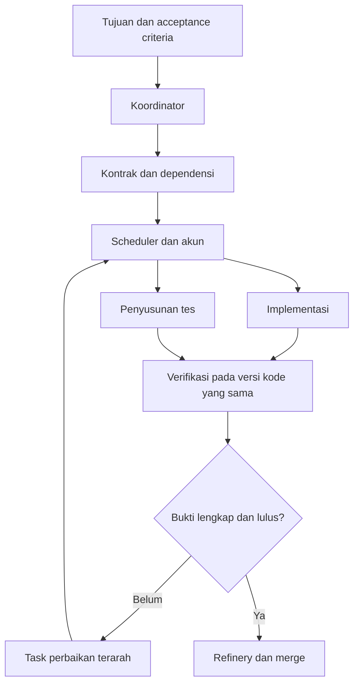

# Gas Town Fork — Insight dan Rekomendasi Implementasi

Tanggal: 12 Oktober 2026.

## Scope dokumen

Strategi arsitektur, urutan implementasi, pilot, pengukuran, dan pengelolaan fork. ID enhancement mengacu ke `02-enhancement-backlog.md`. Temuan sumber dan batas penelitian berada di `01-summary.md`.

## 1. Prinsip keputusan

1. Optimalkan jumlah pekerjaan yang lolos verifikasi dan merged, bukan jumlah agent aktif.
2. Pisahkan keputusan kreatif agent dari invariant sistem seperti kepemilikan task, kapasitas, dan bukti kelulusan.
3. Gunakan Beads sebagai sumber status pekerjaan; telemetry menyimpan observasi, bukan status pesaing.
4. Pertahankan identitas worker dan task meskipun sesi, akun, atau model berganti.
5. Shared knowledge harus memiliki sumber dan versi. Credential serta file sesi aktif tetap terisolasi.
6. Terapkan perubahan kecil yang dapat diukur dan dikembalikan.

## 2. Arsitektur yang direkomendasikan

| Lapisan | Tanggung jawab | Komponen yang dimanfaatkan | Enhancement |
| --- | --- | --- | --- |
| Perencanaan | Tujuan, scope, kontrak, dependensi | Mayor, formula, Beads | E04 |
| Penjadwalan | Admission control, prioritas, pemilihan runtime/akun | Scheduler dan runtime configuration | E01, E02, E06, E08 |
| Eksekusi | Workspace, task ownership, checkpoint | Polecat, worktree, lifecycle | E03, E07, E09 |
| Verifikasi | Tes, evidence, review, pemeriksaan visual | Formula dan quality gates | E05, E10, E11, E12 |
| Integrasi | Antrean merge dan pemeriksaan hasil gabungan | Refinery | E05, E06 |
| Observasi | Korelasi task/run dan pengukuran hasil | Telemetry | E13, E14 |
| Persistensi | Status, dependensi, kompatibilitas data | Beads/Dolt | E15 |



Penyusunan tes boleh paralel dengan implementasi setelah kontrak stabil. Eksekusi tes akhir harus menguji kombinasi versi kode yang akan diintegrasikan.

## 3. Pembagian agent awal

| Peran | Penempatan awal sesuai preferensi pengguna | Kewenangan |
| --- | --- | --- |
| Koordinator | Claude akun A | Membagi task dan menjaga dependensi |
| Planner/specialist | Claude akun B | Analisis arsitektur, kontrak, dan masalah kompleks |
| Implementer backend | Worker sesuai hasil evaluasi | Implementasi scope yang ditugaskan |
| Implementer UI | Codex/GPT melalui runtime yang sesuai | Implementasi berdasarkan desain, token, dan kontrak |
| Pembuat desain gambar | Adapter image generation | Membuat artefak desain sesuai brief |
| Test author | Gemini melalui runtime yang tervalidasi | Menulis skenario dari acceptance criteria |
| Test runner | Proses otomatis | Menjalankan tes dan merekam evidence |
| Reviewer | Worker independen, misalnya Codex/GPT | Menilai diff dan bukti tanpa mengesahkan klaim secara otomatis |
| Integrator | Refinery | Menegakkan quality gates dan merge |

Rekomendasi operasional:

- Satu koordinator aktif untuk lingkup pekerjaan yang sama. Jika dua koordinator aktif, bagi kewenangan berdasarkan rig atau convoy secara eksplisit.
- Banyak akun tidak mengharuskan semuanya selalu aktif. Kapasitas tes dan merge bisa menjadi bottleneck sebelum kapasitas model habis.
- Bedakan penulisan tes oleh agent dari eksekusi tes oleh runner. Runner tidak membutuhkan penalaran LLM untuk setiap langkah.
- Reviewer independen memberi perspektif tambahan, tetapi hasil review tetap membutuhkan bukti. Dua agent yang setuju dapat sama-sama keliru.
- Cadangkan kapasitas untuk recovery dan koordinasi agar seluruh sistem tidak berhenti ketika worker menghabiskan kapasitas akun.

## 4. Urutan implementasi

| Tahap | Scope | Output | Gate untuk lanjut |
| --- | --- | --- | --- |
| 0 — Baseline | Pin versi Gas Town, Beads, runtime; inventaris data existing; logging minimum | Matriks versi dan hasil workflow representatif | Kegagalan dapat direproduksi dan metrik awal tersedia |
| 1 — Kontrak dan identitas | E04, E01, pemeriksaan E15 | Task schema dan account/runtime adapter awal | Task dan identitas worker dapat ditelusuri lintas sesi |
| 2 — Keandalan | E03, E05, checkpoint minimum dari E09 | Claim aman dan penyelesaian berbasis evidence | Restart tidak menggandakan penyelesaian; evidence usang ditolak |
| 3 — Paralelisme | E02, E06, E10 | Kapasitas terkontrol dan tes terisolasi | Worker tambahan meningkatkan hasil tervalidasi tanpa lonjakan konflik |
| 4 — Spesialisasi | E07, E08, E11, E12; recovery lengkap E09 | Konteks konsisten dan pipeline per jenis pekerjaan | Kualitas terjaga pada kombinasi runtime yang digunakan |
| 5 — Optimasi | Dashboard E13 dan evaluasi E14 | Kebijakan routing berdasarkan hasil | Perubahan kebijakan terukur dan dapat di-rollback |

E15 naik menjadi P0 jika akses Beads/Dolt existing menjadi prasyarat pilot. Pengumpulan metrik dimulai pada tahap 0 meskipun dashboard lengkap baru dibuat pada tahap 5.

Durasi sengaja tidak ditetapkan sebelum baseline dan gap terhadap upstream terbaru diketahui. Sebagian item mungkin cukup berupa konfigurasi atau penguatan mekanisme existing.

## 5. Pilot yang disarankan

Pilih satu vertical slice RentalPro yang mencakup kontrak API, backend, mobile, tes, dan review. Contoh: validasi benturan periode reservasi, dengan aturan bisnis yang terlebih dahulu dikonfirmasi.

### Urutan pilot

1. Tetapkan baseline commit, definisi interval waktu, aturan bisnis, dan acceptance criteria.
2. Koordinator membuat task kontrak, implementasi backend, implementasi UI, tes, dan review dengan dependensi yang jelas.
3. Setelah kontrak stabil, jalankan implementasi backend, UI, dan penyusunan tes secara paralel sesuai kapasitas.
4. Integrasikan perubahan yang diperlukan pada target pengujian yang sama.
5. Jalankan tes otomatis dan review; simpan hasil terkait commit dan environment.
6. Kirim hasil yang lulus ke refinery dan jalankan gate integrasi yang relevan.
7. Catat rework, intervensi manual, waktu tunggu, dan hasil akhir.

### Skenario keandalan wajib

- Dua dispatch berlomba mengambil task yang sama.
- Worker mati setelah claim tetapi sebelum spawn atau sebelum laporan sukses.
- Worker lama kembali aktif setelah task dialihkan.
- Akun tidak tersedia di tengah pekerjaan.
- Integration test berjalan lama tanpa output terminal.
- Target branch berubah setelah tes awal lulus.
- Dua test suite mengakses fixture atau port yang semula sama.
- Kontrak API berubah ketika implementasi mobile belum selesai.

Pilot berhasil bila hasil tetap benar dan dapat ditelusuri pada skenario tersebut, bukan hanya berhasil pada happy path.

## 6. KPI dan cara membacanya

| KPI | Definisi operasional | Kegunaan |
| --- | --- | --- |
| Verified throughput | Jumlah task dengan evidence wajib lengkap dan merged per periode | Ukuran output utama |
| First-pass success | Task yang lolos verifikasi pertama tanpa revisi / task yang memasuki verifikasi | Menilai ketepatan implementasi awal |
| Lead time | Waktu sejak task dinyatakan ready hingga merged | Menilai waktu penyelesaian end-to-end |
| Queue time | Durasi menunggu akun, resource, dependensi, review, atau merge | Menentukan bottleneck |
| Rework | Jumlah/durasi run perbaikan setelah verifikasi gagal | Menilai biaya ketidakakuratan |
| Conflict rate | Task yang memerlukan penyelesaian konflik / task yang masuk integrasi | Menilai kualitas pembagian scope |
| Manual intervention | Jumlah intervensi manusia per task selesai | Menilai beban operasional |
| Escaped defects | Bug setelah merge yang ditautkan kembali ke perubahan | Menilai kualitas hasil akhir |
| Cost per verified task | Biaya yang benar-benar terukur / task tervalidasi | Menilai efisiensi biaya |
| Recovery loss | Pekerjaan yang harus diulang setelah gangguan | Menilai kualitas checkpoint |

Gunakan median dan persentil tinggi untuk waktu penyelesaian jika sampel memadai. Bandingkan task dengan kompleksitas sebanding dan versi toolchain yang tercatat.

Untuk subscription tanpa data biaya per request, tampilkan biaya langganan teralokasi sebagai estimasi yang terpisah dari biaya aktual. Jangan mengubah data unknown menjadi nol.

Target numerik ditetapkan setelah baseline. Dokumen ini tidak mengklaim peningkatan produktivitas dalam persentase tertentu.

## 7. Rekomendasi menjaga fork tetap maintainable

- Simpan aturan proyek dan workflow dalam formula/configuration jika extension point yang ada mencukupi.
- Pisahkan adapter provider agar perubahan CLI satu provider tidak memengaruhi scheduler inti.
- Batasi perubahan core pada invariant yang harus ditegakkan oleh program: claim, fencing, capacity, evidence, dan transition validation.
- Pin upstream commit dan versi dependency yang diuji; buat catatan kompatibilitas sebelum upgrade.
- Kirim bug fix generik ke upstream bila memungkinkan agar beban patch jangka panjang berkurang.
- Uji jalur end-to-end yang benar-benar memakai adapter dan scheduler. Tes unit yang hanya memeriksa struktur data belum membuktikan integrasi bekerja.
- Jangan menganggap sistem plugin yang dijelaskan dokumen desain sudah tersedia tanpa mengecek source dan lifecycle aktual.

## 8. Hal yang sebaiknya ditunda

| Ide | Alasan ditunda | Kapan layak dikerjakan |
| --- | --- | --- |
| Mengaktifkan seluruh akun sekaligus | Bisa memperbesar antrean tes dan merge | Setelah kapasitas aktual terukur |
| Banyak koordinator pada task yang sama | Menambah risiko keputusan dan dispatch bertabrakan | Setelah pembagian kewenangan dan ownership kuat |
| Full consensus untuk semua perubahan | Mahal dan menghasilkan review berulang | Untuk keputusan berisiko tinggi yang membutuhkan perspektif tambahan |
| Database task baru | Membuat status ganda dan migrasi tambahan | Jika keterbatasan Beads terukur tidak dapat diatasi |
| Menyatukan seluruh folder config provider | Berisiko mencampur credential dan state mutable | Gunakan shared knowledge terkurasi sebagai gantinya |
| Routing adaptif otomatis sejak awal | Data evaluasi belum cukup | Setelah telemetry dan kumpulan evaluasi stabil |
| Migrasi Dolt langsung pada data utama | Risiko kompatibilitas dan kehilangan keterlacakan | Setelah dry-run dan rollback tervalidasi pada salinan |

## 9. Format epic/task untuk tindak lanjut

Setiap E01–E15 dapat menjadi kandidat epic, tetapi pisahkan investigasi gap dari implementasinya. Berikut template isi task; ini bukan jaminan sintaks CLI Beads tertentu.

```markdown
# [E03] Tolak penyelesaian dari worker dengan lease kedaluwarsa

## Tujuan
Hanya pemilik task dengan generasi aktif yang dapat menyelesaikan pekerjaan.

## Scope
- Validasi ownership pada penerimaan hasil.
- Penanganan takeover dan stale completion.

## Non-goals
- Mengubah metode autentikasi provider.

## Dependensi
- Identitas worker dan run tersedia.
- Mekanisme claim dan lease disepakati.

## Acceptance criteria
- [ ] Hasil dari generasi aktif diterima.
- [ ] Hasil dari generasi sebelumnya ditolak setelah takeover.
- [ ] Retry hasil yang sama tidak membuat transisi ganda.
- [ ] Alasan penolakan muncul dalam audit event.

## Evidence
- Commit implementasi.
- Perintah tes, environment, dan hasilnya.
- Skenario concurrent claim dan stale completion.

## Notes
- Cantumkan upstream commit yang menjadi baseline.
- Perbarui checklist hanya setelah evidence tersedia.
```

Rekomendasi keputusan awal: bangun fondasi E01–E05, lakukan pemeriksaan E15 sebelum adopsi data, lalu perluas paralelisme melalui E02/E06/E10 berdasarkan hasil pilot.

