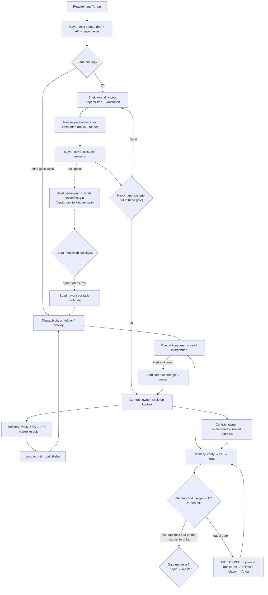

# Re-analisis — Keputusan Arsitektur dan Workflow Operasional

Tanggal: 12 Oktober 2026. Legenda bukti: [V] terverifikasi, [U] laporan upstream, [I] inferensi, [A] asumsi.

## 1. Keputusan arsitektur

Hanya keputusan yang memengaruhi desain, effort, atau cara pakai yang dicantumkan. Kolom "Reversibilitas" menunjukkan biaya membalik keputusan.

### D1 — Sumber kebenaran data task: bd per-repo atau Dolt town

- **Masalah.**
  - Kedua repo Anda memakai bd dengan Dolt server per-repo [V].
  - Gas Town mengasumsikan satu Dolt server per town dengan satu DB per rig [V].
  - `rig add` membuat DB baru yang kosong, dan `dolt migrate` memindahkan data [V].
- **Opsi.**

  | Opsi | Kelebihan | Kekurangan |
  | --- | --- | --- |
  | A. Migrasi penuh backlog existing ke town | Satu sumber kebenaran | Butuh tooling impor yang belum ada, berisiko kehilangan riwayat, dan sulit dibalik |
  | B. Pilot dengan DB town baru untuk epic baru; backlog lama tetap di bd per-repo | Aman, cepat, mudah dibalik | Dua tempat tracking sementara; agent per-repo dan Gas Town tidak boleh mengerjakan epic yang sama |
  | C. Arahkan rig Gas Town ke Dolt server per-repo existing | Tanpa migrasi | Bertentangan dengan model desain; daemon/doctor dapat "memperbaiki" metadata ke DB town [I]; tidak didukung |

- **Rekomendasi:** **B**. Batasi epic secara eksplisit: satu epic hanya di salah satu sistem. Putuskan A setelah pilot terbukti bernilai, lewat spike impor dan verifikasi ID/dependensi.
- **Reversibilitas:** B murah dibalik. A mahal.
- **Status:** **diputuskan B** (Q1, Revisi 1).

### D2 — Penyelarasan versi Beads

- **Masalah.** Embed `beads v1.0.5` vs CLI `bd 1.3.0` [V]. Daemon memblokir store yang lebih baru [V]. Upstream tidak aktif, jadi tidak ada release yang memperbaiki.
- **Opsi.**

  | Opsi | Kelebihan | Kekurangan |
  | --- | --- | --- |
  | A. Naikkan dependensi Beads di fork ke versi `bd` yang dipakai | Konsisten dengan data Anda yang sudah 1.3.x [A] | Effort tidak diketahui (perubahan API/schema, #4793 menyebut kolom yang hilang [U]) |
  | B. Pin CLI `bd` ke versi yang cocok dengan 1.0.5 khusus untuk town | Tanpa ubah kode | `bd` global di PATH dipakai juga oleh project lain; downgrade store 1.3.x kemungkinan tidak didukung [I] |
  | C. Town dengan `bd` terisolasi (PATH khusus via wrapper) + store baru (D1-B) | Tidak menyentuh data existing | Dua versi bd berdampingan; operator harus disiplin |

- **Rekomendasi:** spike **A** selama 1–2 hari, dibatasi waktu. Jika gagal atau terlalu besar, jalankan pilot dengan **C** sambil A dikerjakan.
- **Reversibilitas:** sedang. A adalah perubahan kode fork. C murni operasional.
- **Status:** **diputuskan A** (Q3, Revisi 1), dengan C sebagai fallback sementara.

### D3 — Jalur integrasi: `direct` vs `pr`

- **Masalah.** Workflow Anda mewajibkan PR untuk setiap perubahan [V]. Gas Town default `direct` [V].
- **Opsi.**
  - **`pr` dengan approval manusia per PR child.** Paling aman, tetapi manusia menjadi bottleneck.
  - **`pr` dengan approval hanya di PR epic → master,** sementara child di-merge otomatis setelah gate Rank 2. Throughput lebih tinggi, tetapi bergantung pada kekuatan gate.
  - **`direct` ke `epic/...`.** Paling cepat, tetapi melanggar aturan repo Anda.
- **Rekomendasi:** mulai dengan **`pr` + approval manusia per child** selama pilot. Pindah ke approval di level epic setelah Rank 2 `enforce` dan metrik escaped defect stabil.
- **Catatan inkonsistensi [V]:** formula refinery saat ini selalu menuntut `APPROVED`, sehingga opsi kedua butuh perbaikan Rank 2 (d).
- **Reversibilitas:** murah (konfigurasi).
- **Butuh konfirmasi:** ya (Q2).

### D4 — Di mana gate ditegakkan

- **Opsi.**
  - Prosa formula LLM (kondisi sekarang).
  - Perintah Go deterministik (`gt mq verify`).
  - Branch protection GitHub.
- **Kendala.** GitHub Free + repo privat: rulesets tidak tersedia (tercatat di `workflow.md:32` [V]). Branch protection untuk repo privat di paket Free juga kemungkinan tidak tersedia [A].
- **Rekomendasi:** perintah Go yang membaca evidence `local-ci` per SHA (Rank 2). Formula hanya memanggilnya.
- **Reversibilitas:** murah.
- **Butuh konfirmasi:** tidak, kecuali Anda punya paket GitHub lain.

### D5 — Konvensi branch

- **Masalah.**
  - Gas Town: `polecat/<name>-<ts>` dan `integration/{title}`.
  - Repo Anda: `<type>/<desc>`, `epic/<nama>`, serta `ai/*`/`epic/*` yang tidak pernah dihapus [V].
- **Opsi.**
  - Konfigurasi template Gas Town agar mengikuti konvensi Anda.
  - Ubah aturan repo agar menerima branch polecat.
- **Rekomendasi:**
  - `integration_branch_template=epic/{title}`.
  - Untuk polecat, gunakan prefix yang tidak dilindungi dan mudah dibersihkan, mis. `feat/gt-{bead}`. Variabel yang didukung `polecat_branch_template` perlu dicek di pilot [A].
  - Hindari prefix `ai/`, karena tidak pernah dihapus otomatis dan akan menumpuk.
  - Wave CI (`ci/<epic>-wave<n>`) digantikan merge rehearsal refinery per MR. Branch wave tetap boleh dipakai untuk verifikasi gabungan sebelum PR epic → master.
- **Reversibilitas:** murah.
- **Butuh konfirmasi:** ya, untuk penamaan (Q6).

### D6 — Mode fork: produk vs kontribusi upstream

- **Masalah.** Upstream tidak aktif [V], sehingga kontribusi mungkin tidak di-merge.
- **Rekomendasi:** **fork produk**.
  - Patch kecil dan terisolasi per enhancement, masing-masing dengan test.
  - Workflow spesifik project ditaruh di overlay formula atau konfigurasi (`docs/design/directives-and-overlays.md`), bukan di core.
  - Invariant (gate, guard, state) ditaruh di Go.
  - Tetap tulis patch dalam bentuk yang bisa di-PR ke upstream jika aktivitasnya kembali.
- **Reversibilitas:** sedang. Semakin banyak divergensi, semakin mahal kembali ke upstream.
- **Butuh konfirmasi:** ya (Q7).

### D7 — Runtime dan akun per peran (direvisi di Revisi 1)

- **Keputusan Anda:** multi-akun lintas-provider (E01) menjadi prioritas. Lihat Rank 4 di `09`.
- **Rekomendasi.**
  - Runtime utama tetap Claude untuk semua role selama pilot. Beberapa akun Claude didaftarkan sejak P0.3.
  - Provider lain dipakai sebagai **fallback** saat akun Claude limit (4b), bukan sebagai runtime utama, sampai ada data kualitas per provider.
  - Eksperimen terkontrol (mis. role reviewer memakai provider lain) tetap dilakukan setelah event `gate.result` terkumpul, sebagai masukan E08/E14.
- **Reversibilitas:** murah (konfigurasi), kecuali kode 4a/4b.
- **Butuh konfirmasi:** provider fallback mana yang tersedia (Q10 di `12`).

### D8 — Format artefak kontrak BE ↔ mobile

- **Masalah.** Rank 3 membutuhkan `contract_ref`. Format kontrak di BE belum diperiksa (OpenAPI/springdoc, dokumen `docs/spec`, atau DTO).
- **Rekomendasi:** pakai artefak yang **sudah** dihasilkan BE. Kontrak di-pin dengan path + SHA. Jangan membuat format baru.
- **Reversibilitas:** murah.
- **Butuh konfirmasi:** ya (Q5).

### D9 — Cara agent mencapai kesepakatan sebelum implementasi (baru, Revisi 1)

- **Masalah.** Usulan Anda: agent melakukan briefing dan membuat keputusan bersama sebelum mengerjakan task, dengan owner khusus untuk area bersama.
- **Opsi.**

  | Opsi | Kelebihan | Kekurangan |
  | --- | --- | --- |
  | A. Diskusi bebas multi-agent sampai sepakat | Paling fleksibel | Konsumen (polecat) belum ada saat briefing; tidak ada protokol terminasi; konsensus LLM bukan bukti kebenaran; biaya N × ronde |
  | B. Propose → review terstruktur per area konsumen (maks 2 ronde) → cek mekanis Mayor → approval Anda | Berakhir pasti; menghasilkan artefak; memakai formula convoy yang ada | Kurang "dialogis"; keberatan kompleks naik ke Anda |
  | C. Tanpa briefing; Mayor menyusun dependensi sendiri | Paling murah | Tidak ada pemeriksaan dari sudut pandang konsumen; konflik area bersama tetap terjadi |

- **Rekomendasi:** **B** untuk epic yang menyentuh hot path, kontrak lintas-rig, atau ≥ 3 bead paralel per rig. **C** untuk epic kecil. Detail di `12` § 2.
- **Reversibilitas:** murah (overlay formula).
- **Status (Revisi 3):** brief disetujui **Mayor**. Hal krusial dikumpulkan sebagai pertanyaan untuk Anda, pekerjaan berbasis asumsi diberi tanda, dan rework dilakukan berdasarkan tanda setelah Anda menjawab (`14`).

### D10 — Mekanisme akun bersamaan (Revisi 1, direvisi total di Revisi 2)

- **Kebutuhan Anda (Revisi 2).** Beberapa akun bersamaan, satu config global per runtime. Hanya kredensial yang berbeda. Anda sudah memakai claude-swap untuk sesi interaktif.
- **Opsi** (detail di `13` § 5):
  - A. Token per proses (`CLAUDE_CODE_OAUTH_TOKEN` dari `setup-token`), config tunggal penuh.
  - B. `cswap run` (profil per akun; rules, plugins, dan direktori kustom tidak ikut).
  - C. Home per akun buatan Gas Town dengan denylist symlink.
  - D. Swap global (rotasi keychain bawaan atau `cswap switch`), yang tidak mendukung akun bersamaan.
- **Rekomendasi:** **A** untuk sesi agent Gas Town. claude-swap tetap untuk sesi interaktif Anda dan opsional sebagai sumber data kuota. Gas Town tidak menyentuh entri Keychain default dan `oauthAccount`.
- **Koreksi:** rekomendasi Revisi 1 (Rotator swap `CLAUDE_CONFIG_DIR`) **dibatalkan** karena memecah config (`13` K21).
- **Reversibilitas:** murah sampai sedang (launcher + registry).
- **Status:** **diputuskan A** (Q12: connectors/Remote Control tidak dibutuhkan). Provider fallback memakai login berlangganan (Q10), sehingga 4b memakai home per akun dengan denylist symlink, didahului spike.

## 2. Workflow operasional yang direkomendasikan

Asumsi contoh berdasarkan struktur yang sudah diperiksa:

- Rig `be` → `oto-rent-be` (Gradle multi-module).
- Rig `pro` → `oto-rent-pro` (Flutter).
- Satu town pilot, 2–4 polecat, mode `pr`, D1-B.

### 2.1 Peran dan kepemilikan

| Peran | Pelaku | Memiliki | Tidak boleh |
| --- | --- | --- | --- |
| Product owner / approver | Anda | Requirement, approval spec dan kontrak, approval PR (D3), merge epic → master | — |
| Mayor (koordinator) | Agent Claude, satu aktif per town | Menyusun epic, bead, dependensi, dan convoy; menjalankan briefing dan cek konsistensi brief; menangani eskalasi | Mengubah kode; menutup bead tanpa evidence; menyetujui brief yang belum direview; memutuskan sendiri hal krusial (`14` § 2.2); menganggap pertanyaan yang tidak dijawab sebagai setuju |
| Contract architect | Langkah formula `mol-contract-brief` (dijalankan Mayor atau polecat khusus) | Draf brief: kontrak, peta kepemilikan, konsumen, keputusan | Memutuskan keberatan `conflict` sendiri |
| Reviewer brief | Leg convoy per area konsumen | Verdict `ok\|gap\|conflict` per bead konsumen | Mengubah brief langsung |
| Contract owner | Crew `contract-owner` per rig | Skeleton kontrak dan implementasi area bersama (hot path) di rig-nya | Mengerjakan bead konsumen |
| Polecat (implementer) | Agent per bead, worktree terpisah | Satu bead dari hook sampai `gt done` | Menyentuh worktree lain; mengubah path milik owner (ajukan `contract-change`); menambah test mobile tanpa izin (aturan repo) |
| Refinery | Agent + `gt mq verify` (Rank 2) | Merge rehearsal, gate, PR, dan merge ke `epic/...` | Merge tanpa evidence; menilai "pre-existing" tanpa override manusia |
| Witness / daemon | Proses | Liveness, respawn, dan eskalasi | Kill saat state `unknown` (Rank 5); restart sesi yang `limited` ke akun yang sama (Rank 4a) |
| Test runner | Skrip deterministik (`make ci-local`, `fvm flutter test`) | Menghasilkan evidence | — |

### 2.2 Alur end-to-end

| Tahap | Aktivitas | Output wajib |
| --- | --- | --- |
| 1. Requirement | Anda menulis tujuan, aturan bisnis, dan batasan. Untuk aturan bisnis yang ambigu, Mayor bertanya dulu, tidak menebak | Requirement tertulis (bisa di `docs/spec` BE) |
| 2. Perencanaan | Mayor membuat epic dan bead child sesuai `bd-issue-policy` (deskripsi, checklist, AC, notes, `--actor`); dependensi `blocks`; convoy lintas-rig | Bead draf yang lolos readiness (Rank 1) |
| 2b. Briefing (bila wajib) | Brief disusun, direview per area konsumen, dicek mekanis oleh Mayor. Bead skeleton kontrak di-assign ke crew `contract-owner`; bead konsumen bergantung pada skeleton dan gate | Brief di repo + bead gate terbuka |
| 3. Approval brief | Mayor menyetujui brief setelah review dan cek mekanis. Hal krusial menjadi bead pertanyaan; task terkait diberi tanda `assumes:Q-*` atau ditahan (`block`) | Bead gate ditutup Mayor; daftar pertanyaan terbuka |
| 4. Pembagian agent | Scheduler (`max_polecats` = 2–4) men-dispatch bead yang siap: blocker selesai, termasuk gate brief dan skeleton kontrak (Rank 3) | Event dispatch + alasan |
| 5. Implementasi | Polecat di worktree dari `epic/<nama>`; membaca kontrak penuh dari prime; build + test terarah; self-review; `gt done` | Commit + branch + catatan AC yang dicentang beserta bukti |
| 6. Testing | Refinery menjalankan gate deterministik pada merge rehearsal (BE: `ci-local` dengan port dari `GT_POLECAT`; mobile: analyze + test) | Evidence `{sha, perintah, exit, log}` di MR |
| 7. Review | PR ke `epic/<nama>`: approval manusia (D3). Reviewer AI opsional untuk label risiko (`payment`, `rbac`, `migration`), sebagai masukan, bukan gate | Review decision |
| 8. Integrasi | `gt mq verify` lulus pada SHA head → merge. Konflik → task resolusi otomatis | PR merged, MR closed |
| 8b. Jawaban pertanyaan | Anda menjawab daftar pertanyaan sekaligus; Mayor menghapus tanda yang cocok dan membuat bead rework untuk yang berbeda | Tidak ada tanda asumsi terbuka |
| 9. Completion | Bead ditutup oleh refinery setelah merge dan semua AC tercentang; epic selesai setelah semua child dan semua rework; Gate manusia 2 untuk epic → master | Epic PR + ringkasan evidence + ringkasan keputusan/asumsi |

### 2.3 Paralel vs berurutan

| Aman paralel | Harus berurutan atau di-serialkan |
| --- | --- |
| Bead BE di `feature/<a>` vs `feature/<b>` yang tidak menyentuh `shared/` atau `core/` | Perubahan `shared/`, `core/` BE (aturan repo melarang dependensi lintas feature, sehingga `shared/` menjadi hot path) |
| Implementasi BE dan penulisan skenario test dari AC | `sql/migration/**`: nomor versi migrasi harus berurutan |
| Bead mobile pada feature folder berbeda | `build.gradle.kts`, `pubspec.yaml`/`pubspec.lock`, dependency bump |
| UI mobile yang tidak bergantung kontrak baru (layout, state lokal) | `app_router.dart` dan file generated `build_runner` |
| | Design tokens (`styles-system`) |
| | Kontrak API → implementasi mobile yang memakainya |

Mekanisme pencegahan tabrakan dari yang paling murah: (1) dependensi `blocks` eksplisit oleh Mayor; (2) peta kepemilikan hot path di brief, dengan satu contract owner per rig (Rank 3); (3) worktree per polecat [V]; (4) resolusi konflik refinery sebagai jaring terakhir [V]. Deteksi overlap otomatis (E06) ditunda.

### 2.4 Kontrak antarproject (BE ↔ mobile)

1. Kontrak disepakati di brief (disetujui Mayor), lalu skeleton-nya dikerjakan oleh crew `contract-owner` BE sebagai bead berlabel `contract` yang memblokir semua bead mobile yang memakainya.
2. Setelah kontrak merged ke `epic/<nama>` BE, `contract_ref=<repo>:<path>@<sha>` dicatat (Rank 3).
3. Bead mobile hanya di-dispatch setelah itu, dan menampilkan `contract_ref` di prime.
4. Perubahan kontrak sesudahnya membuka bead kontrak baru (bukan edit diam-diam) dan menandai downstream `contract-stale`.
5. Mock atau fixture mobile dibuat dari kontrak yang di-pin, sehingga mobile tidak menunggu deploy BE.
6. Batasan: tidak ada atomic merge lintas repo. Epic BE dan epic mobile di-merge ke master secara terpisah, dan urutannya ditentukan Anda di Gate 2 (BE dulu bila mobile bergantung pada endpoint baru).

### 2.5 Blocked, gagal, retry, dan handoff

| Situasi | Penanganan |
| --- | --- |
| Bead tidak lolos readiness | Kembali ke Mayor untuk dilengkapi. Tidak di-dispatch |
| Gate gagal | FIX_NEEDED ke polecat yang sama dengan log. Maksimal 2 putaran, lalu eskalasi ke Mayor, lalu ke Anda. Batas ini dijalankan lewat formula, karena `max_retry_count` belum berfungsi [V] |
| Flaky test | Retry 1× otomatis yang tercatat. Jika masih gagal, perlakukan sebagai gagal dan buat bead `flaky` terpisah |
| Konflik merge | Task resolusi otomatis dari refinery [V]. Jika berulang pada area yang sama, area itu didaftarkan sebagai hot path dengan owner di brief berikutnya (Rank 3) |
| Agent crash / sesi mati | Witness respawn. Konteks berasal dari bead (deskripsi, notes, AC tercentang) dan branch yang sudah di-push, bukan dari memori sesi |
| Usage limit | Status `limited` (Rank 4a). Restart dengan token akun Claude non-limited + `--resume` di atas config global yang sama (D10); bila semua limited, fallback provider sesuai kebijakan (Rank 4b) atau tunggu reset + eskalasi. Jangan restart berulang ke akun yang sama |
| Handoff antar-sesi | Polecat menulis progres ke `bd notes` dan commit kecil yang di-push. `gt handoff` untuk siklus sesi. Tidak ada state penting yang hanya ada di terminal |
| Requirement ternyata salah atau ambigu | Polecat berhenti dan menandai bead `blocked: needs-clarification`. Mayor memutuskan bila bukan hal krusial; bila krusial, Mayor membuat bead pertanyaan (`proceed` dengan asumsi bertanda, atau `block`) sesuai `14` § 2.2. Agent tidak menebak diam-diam |
| Pertanyaan `block` belum dijawab | Hanya task terkait yang tertahan; task lain berjalan. Pengingat ke Anda setelah N jam (default 24) |

### 2.6 Bukti wajib sebelum "selesai"

Sebuah child bead dinyatakan **selesai** bila:

1. PR merged ke `epic/<nama>`.
2. Evidence gate lulus pada SHA yang di-merge (Rank 2).
3. Semua item AC dicentang, dan masing-masing punya rujukan bukti (nama test, langkah verifikasi, atau screenshot untuk UI).
4. Tidak ada override yang belum disetujui manusia.
5. Tidak ada tanda `assumes:*` yang pertanyaannya belum terjawab, dan semua rework terkait sudah merged.

Epic dinyatakan **selesai** bila semua child selesai dan PR epic → master sudah di-merge oleh Anda.

"Task closed" tanpa keempat syarat di atas tidak dihitung dalam verified throughput.

### 2.7 Titik intervensi manusia

| Titik | Alasan |
| --- | --- |
| Daftar pertanyaan krusial (dijawab sekaligus; `block` segera) | Keputusan bisnis dan area mahal tetap di tangan Anda, tanpa menghentikan seluruh pekerjaan |
| Approval PR child (pilot) | Sampai gate Rank 2 terbukti; nanti bisa diturunkan |
| Eskalasi setelah 2× gagal gate atau `needs-clarification` | Agent tidak boleh menebak aturan bisnis |
| Override gate (pre-existing failure, `--force-unready`, `--ignore-deps`) | Pengecualian harus disengaja dan tercatat |
| Gate 2: epic → master | Rilis ke branch utama |
| Operasi data, migrasi, dan upgrade toolchain | Tidak dapat dibalik dengan murah |

## 3. Persiapan untuk UI jangka panjang (kontrak data saja)

Tidak membangun dashboard. Yang layak disiapkan sekarang hanya agar data dari enhancement di atas bisa dibaca UI kelak tanpa migrasi.

- **Satu sumber status:** bead (bd). Event hanya observasi, bukan status pesaing (konsisten dengan prinsip 03 § 1).
- **Event minimum.** Ditulis ke stream event yang sudah ada (`.events.jsonl`/telemetry [V] `internal/telemetry`, `internal/events`). Format: `{type, ts, town, rig, bead, actor, session_id, payload}`.

  | Event | Payload |
  | --- | --- |
  | `task.readiness` | `{result: ready\|rejected\|overridden, reasons[]}` (Rank 1) |
  | `task.dispatch` / `task.deferred` | `{reason: capacity\|blocked\|gate_open\|contract_pending\|unknown_state}` (Rank 3) |
  | `gate.result` | `{mr, sha, base_sha, source, command, exit, duration_ms, log_ref}` (Rank 2) |
  | `merge.result` | `{mr, sha, strategy, pr_url, override?}` |
  | `session.lifecycle` | `{state: started\|limited\|rotated\|stalled\|killed, generation, account, provider, reason}` (Rank 4/5) |
  | `escalation` | `{from, to, reason, attempt}` |
  | `question.opened` / `question.answered` | `{qid, class, assumed?, answer?, affected[], diverged?}` (Revisi 3) |
  | `rework.created` | `{qid, origin_bead, rework_bead}` (Revisi 3) |

- **Aturan data:**
  - `unknown` tidak pernah dirender sebagai 0 atau kosong.
  - Setiap nilai turunan membawa `observed_at`.
  - Biaya yang tidak terukur ditandai `null`, bukan 0.
- **Yang ditunda:** read model, API, agregasi, dan visualisasi (E13). Kerjakan setelah event di atas stabil minimal satu epic.
