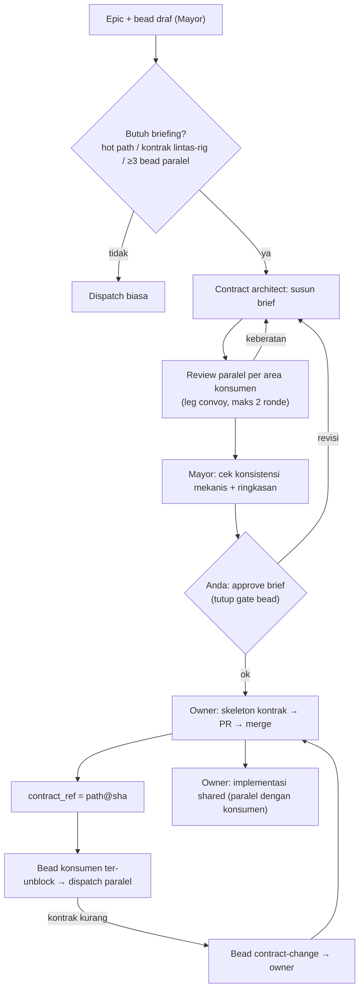

# Re-analisis Revisi 1 — Jawaban Konfirmasi, E01, dan Desain Koordinasi Contract-First

Tanggal: 12 Oktober 2026. Legenda bukti: [V] terverifikasi, [U] laporan upstream, [I] inferensi, [A] asumsi (lihat `07`).

Dokumen ini mencatat perubahan pada 07–11 setelah Anda menjawab pertanyaan konfirmasi dan memberi dua koreksi. Dokumen 07–11 sudah diperbarui. File ini menjelaskan **apa yang berubah dan mengapa**, dan memuat evaluasi atas usulan desain briefing Anda.

## 1. Input dari Anda

| Item | Jawaban/koreksi | Dampak |
| --- | --- | --- |
| Q1 | Ya: pilot memakai DB town baru, backlog lama tetap di bd per-repo | D1-B final. P0.2 tetap S |
| Q3 | Naikkan Beads di fork | D2-A final. Fallback C hanya bila spike melebihi 2 hari |
| Q4 | `make ci-local` ±4 menit | Gate satu tingkat per MR cukup. Desain gate dua tingkat di Rank 2 dihapus |
| Q9 | Boleh indeks | Repo sudah diindeks di `codebase-memory-mcp`. Klaim kunci diverifikasi ulang via graph (§ 4) |
| Koreksi 1 | E01 (multi-akun lintas-provider) harus menjadi prioritas | E01 masuk top 5 sebagai Rank 4, dengan scope yang dipersempit (§ 3) |
| Koreksi 2 | Usulan briefing antar-agent + agent khusus pemilik kontrak + konsumen terblokir + finalisasi Mayor | Menggantikan E06 (deteksi overlap) sebagai mekanisme utama pencegahan konflik. Menjadi Rank 3 (§ 2) |
| Q2, Q5–Q8 | "Aman, tidak ada koreksi" | Default yang tertulis di `11` § 4 berlaku |

Ranking baru (detail di `09` § 4):

| Rank | Sebelumnya | Sekarang |
| --- | --- | --- |
| 1 | E04 kontrak task utuh | **Tetap** |
| 2 | E05 gate evidence SHA | **Tetap**, disederhanakan karena gate 4 menit |
| 3 | E16 state fail-closed | **E31+ Koordinasi contract-first** (usulan Anda + guard dependensi + pin kontrak) |
| 4 | E31 guard dependensi lintas-rig | **E01 slice: failover akun & fallback provider** |
| 5 | E06 deteksi overlap (kondisional) | **E16 slice** (tanpa poin usage-limit, yang pindah ke Rank 4) |

E06 versi otomatis (deteksi overlap dari label scope) **ditunda**. Kepemilikan hot path di Rank 3 mencegah konflik lebih langsung dan lebih murah divalidasi.

## 2. Evaluasi usulan briefing dan contract owner

### 2.1 Ringkasan pendapat

Arah usulan Anda **benar dan lebih baik** daripada rekomendasi saya sebelumnya (E06). E06 mendeteksi overlap setelah bead dibuat. Usulan Anda **mencegah** overlap lewat desain kerja: setiap area bersama punya satu penulis, dan konsumen menunggu kontrak final. Ini prinsip *single-writer* + *contract-first*, pola yang terbukti di tim manusia.

Ada empat bagian yang menurut saya perlu diubah agar berjalan andal dengan agent LLM di Gas Town:

| # | Bagian usulan | Masalah bila dijalankan apa adanya | Usulan perubahan |
| --- | --- | --- | --- |
| R1 | Agent saling berkomunikasi dan briefing untuk mencapai keputusan bersama | Lihat § 2.2 | Ganti diskusi bebas dengan **propose → review terstruktur → decide**, dibatasi ronde |
| R2 | Kesepakatan antar-agent | Kesepakatan berbentuk percakapan tidak bisa ditegakkan dan mudah hilang | Kesepakatan = **artefak** (`brief` di repo + field bead), di-pin `path@sha`, dan dicek mesin |
| R3 | Konsumen terblokir sampai pekerjaan contract owner selesai | Jika yang ditunggu adalah *implementasi* shared service, seluruh epic menjadi serial | Pecah kerja owner: **skeleton kontrak** (memblokir) vs **implementasi** (umumnya tidak memblokir) |
| R4 (diganti di Revisi 3, lihat `14`) | Finalisasi oleh Mayor | Mayor juga LLM; validasi kesepakatan oleh LLM yang sama dengan penyusun berisiko bias konfirmasi | Mayor menjalankan **cek konsistensi mekanis** + merangkum; **Anda** meng-approve brief selama pilot (1 approval per epic/wave) |

Tiga tambahan:

- **R5 — Jalur perubahan kontrak.** Konsumen yang menemukan kontrak tidak memadai **tidak boleh** mengedit area milik owner. Konsumen membuat bead `contract-change`. Owner merevisi, `contract_ref` naik, dan konsumen terkait diberi label `contract-stale`.
- **R6 — Briefing tidak selalu wajib.** Briefing menambah biaya dan latensi. Wajibkan hanya bila epic menyentuh hot path, kontrak lintas-rig, atau ≥ 3 bead paralel di rig yang sama. Epic kecil langsung ke dispatch.
- **R7 — "Agent khusus" diwujudkan sebagai crew per rig, bukan role baru.** Detail di § 2.4.

### 2.2 Mengapa bukan diskusi bebas antar-agent (R1)

1. **[V] Konsumen belum ada saat briefing.** Polecat dibuat per bead saat dispatch. Saat kontrak disusun, belum ada agent konsumen yang hidup untuk diajak berdiskusi. Agent yang "mewakili" konsumen sebenarnya adalah reviewer yang membaca rencana bead konsumen. Itu lebih tepat dimodelkan sebagai leg review.
2. **[I] Konsensus LLM bukan bukti kebenaran.** Beberapa agent dengan model sama cenderung cepat sepakat. Kesepakatan tidak menjamin kontrak benar terhadap requirement. Yang menjamin adalah cek terhadap AC dan approval manusia.
3. **[I] Biaya dan terminasi.** N agent × R ronde × konteks penuh. Tanpa protokol, tidak ada jaminan diskusi berhenti atau menghasilkan keputusan.
4. **[V] Infrastruktur diskusi ada, tetapi protokolnya tidak.** Gas Town punya mail thread, `@group`, dan channel pub/sub yang durable (`internal/mail/types.go:96-100`, `mail/router.go:894`, `:1410-1431`). Namun tidak ada turn-taking, kuorum, atau aturan keputusan. Laporan pesan hilang masih OPEN (#4634/#4711/#4607 [U]).
5. **[V] Pola review terstruktur sudah ada.** Formula convoy menjalankan leg review paralel lalu satu langkah sintesis (`design.formula.toml`: leg api, data, ux, scale, security, integration). Formula `mol-idea-to-plan` sudah berisi intake, review PRD, `human-clarify` dengan target Mayor, desain, review rencana, lalu pembuatan bead dan dependensi (`mol-idea-to-plan.formula.toml:7-31`, `:153-205`, `:689-765`).

Kesimpulan: tujuan briefing Anda (kesepakatan sebelum kerja) dicapai dengan protokol review terstruktur, bukan rapat bebas. Hasilnya lebih murah, punya akhir yang jelas, dan meninggalkan artefak yang bisa diaudit.

### 2.3 Protokol yang direkomendasikan

**Isi brief (artefak tunggal per epic/wave):**

| Bagian | Isi | Dipakai oleh |
| --- | --- | --- |
| Kontrak | Daftar artefak: endpoint/OpenAPI, DTO, interface service, skema/nomor migrasi, API komponen UI bersama, design token | Owner (implementasi), konsumen (prime via `contract_ref`) |
| Peta kepemilikan | `path-glob → owner bead` untuk setiap hot path yang disentuh epic | Guard di `gt done` (diff konsumen di path milik owner) |
| Konsumen | Bead mana memakai kontrak mana | Dependensi `blocks` yang dibuat otomatis |
| Keputusan & alasan | Opsi yang ditolak dan alasannya | Review manusia; mencegah debat ulang |
| Pertanyaan terbuka | Hal yang butuh keputusan bisnis | Anda, sebelum approve |

**Aturan review (pengganti "diskusi"):**

- Setiap reviewer mewakili satu area konsumen dan menjawab pertanyaan tetap: "Bisakah bead X diimplementasikan hanya dengan kontrak ini? Sebutkan field atau perilaku yang kurang, konflik dengan kode existing, dan asumsi yang tidak tertulis."
- Output reviewer terstruktur: `{bead, verdict: ok|gap|conflict, items[]}`.
- Maksimal 2 ronde. Bila masih ada `conflict`, keputusan naik ke Anda. Agent tidak memutuskan sendiri.

**Cek konsistensi mekanis oleh Mayor (bukan penilaian LLM):**

- Setiap hot path yang disentuh epic punya tepat satu owner.
- Setiap bead konsumen punya dependensi ke skeleton kontrak yang dipakainya.
- Tidak ada siklus dependensi.
- Setiap item kontrak punya AC di bead owner.
- Nomor migrasi direservasi dan tidak bentrok dengan `epic/*` lain yang terbuka.

### 2.4 Pemetaan ke primitif Gas Town (diverifikasi via graph + Read)

| Kebutuhan | Primitif yang ada | Status |
| --- | --- | --- |
| Penyusunan rencana dan bead | `mol-idea-to-plan` (prompt-driven; agent menjalankan `bd create`/`bd dep add`) | [V] Ada & jalan. Berat (beberapa review 6-leg × 3 ronde); butuh overlay yang dipangkas |
| Review paralel + sintesis | Formula convoy (`design`, `mol-plan-review`), `executeConvoyFormula` (`cmd/formula.go:429`) | [V] Ada. `TriggerSynthesisIfReady` (`cmd/synthesis.go:692`) **tanpa caller**, jadi sintesis harus dipicu manual (`gt synthesis start`) |
| Gelombang (wave) berdasarkan dependensi | `gt convoy stage` (Kahn waves; bead `gate`/`decision`/`epic` yang terbuka menahan dependennya) dan `launch` yang hanya men-dispatch wave 1 (`convoy_stage.go:990-1092`, `convoy_launch.go:158-190`) | [V] Ada & jalan. Wave dihitung, tidak disimpan |
| Blokir konsumen | Dependensi `blocks`/`waits-for`/`merge-blocks` di feed convoy (`convoy/operations.go:181-186`) dan scheduler (`capacity_dispatch.go:866-927`) | [V] Scheduler fail-closed. **Feed fail-open** saat store/lookup error (`operations.go:202-218`). **Sling manual tidak memeriksa dependensi** |
| Gate approval | Tipe bead `gate` (`constants/constants.go:183-185`) | [V] Ada, tetapi patrol Deacon hanya menutup gate timer/GitHub; gate manusia/mail dilewati (`mol-deacon-patrol.formula.toml:345-371`). Approval = Anda menutup bead gate secara manual. Tidak ada notifikasi |
| Agent khusus | Role tetap; nama role kustom ditolak (`config/roles.go:143-145`). Crew bernama + `gt sling --crew <name>` (`sling.go:306-308`). `target` di step workflow → `workflow_target` diarahkan ke worker tersebut (`sling_helpers.go:119-160`) | [V] Ada. Routing `workflow_target` lewat feed daemon: [I] keyakinan sedang, belum diuji |
| Instruksi khusus owner | Directives per role per rig (`<town>/<rig>/directives/<role>.md`, `directives.go:9-41`) | [V] Per role, **bukan per nama**. Instruksi owner lebih tepat diletakkan di formula step |
| Komunikasi | Mail thread/reply, `@group`, channel durable | [V] Ada. Dipakai untuk notifikasi dan pertanyaan, bukan pengambilan keputusan |
| Formula validasi PRD | `appendValidationWave` merujuk `mol-validate-prd` (`convoy_stage.go:1094-1097`) | [V] **File formula tidak ada**. Bug kecil, masuk quick wins |

**Pilihan wujud contract owner:**

| Opsi | Kelebihan | Kekurangan |
| --- | --- | --- |
| A. Crew `contract-owner` per rig (persisten) | Konteks kontrak terbawa antar-bead dalam satu epic; satu penulis per rig secara alami | Kapasitas satu worker; harus dijaga tetap ringan (skeleton saja) |
| B. Polecat biasa + formula `mol-contract-work` + label `contract` | Tidak butuh setup crew; skala ikut scheduler | Tidak ada jaminan satu penulis; dua bead kontrak bisa jalan paralel di hot path yang sama |
| C. Role baru `contract-owner` di core | Paling eksplisit | Role kustom ditolak di core; perubahan besar di fork |

Rekomendasi: **A untuk pilot**. Opsi A memberi jaminan satu penulis tanpa kode baru. Instruksi owner dibawa formula step. Pindah ke B bila crew menjadi bottleneck (antrean skeleton > 1 hari).

### 2.5 Risiko yang tetap ada

- **Kontrak yang salah tetap salah, hanya lebih rapi.** Protokol ini mengurangi konflik teknis, bukan kesalahan requirement. Penangkalnya tetap Rank 1 (AC utuh) dan approval Anda.
- **Owner menjadi titik serial.** Diukur dengan "waktu tunggu konsumen terhadap skeleton". Bila besar, pecah owner per area (BE `shared/`, BE migrasi, mobile UI kit).
- **Brief kedaluwarsa.** Perubahan di luar jalur `contract-change` hanya terdeteksi oleh guard path milik owner di `gt done`. Mode awal `warn`.
- **Biaya token briefing.** Diukur per epic. Aturan R6 mencegah briefing pada epic kecil.

## 3. E01: apa yang sudah ada dan scope yang dipilih

### 3.1 Koreksi atas pernyataan saya sebelumnya

Pernyataan di `07` versi awal ("multi-akun tidak seburuk anggapan 01/02") benar sebagian, tetapi **terlalu ringkas dan melewatkan dua hal penting**:

1. **[V] Mesin rotasi lebih lengkap dari yang saya tulis.** Ada `gt account add|list|default|status|switch` (`cmd/account.go:24-39`) dan `gt quota scan|rotate|watch`. Scanner membaca pane **semua** sesi, termasuk polecat (`quota/scan.go:100-117`). Rotasi memilih akun bebas yang paling lama tidak dipakai (`quota/state.go:162-172`), lalu me-respawn pane dengan `--continue` (`cmd/quota.go:663-802`). Patrol `quota_dog` menjalankannya tiap 5 menit, tetapi **default off**.
2. **[V] Cara rotasinya punya risiko keamanan dan kebijakan.** Rotasi produksi **menyalin token OAuth** dari keychain akun lain ke entri keychain akun yang terkena limit (`quota/keychain.go:85-110`, `:125-178`). Token dikirim sebagai argumen command line (`keychain.go:66-71`), sehingga sesaat terlihat di `ps`. `SyncSwappedTokens` terus menyebarkan token (`:292-324`). Ada juga `account switch` yang bisa `RemoveAll` direktori config sebelum memindahkan `~/.claude` (`cmd/account.go:427-435`), sehingga berisiko kehilangan data.

Gap yang nyata:

| Gap | Bukti |
| --- | --- |
| Status limited tidak disimpan setelah rotasi, sehingga akun yang baru kena limit dianggap tersedia | [V] `cmd/quota.go:424-428`; `Manager.MarkLimited` hanya dipanggil test |
| Rotator berbasis swap `CLAUDE_CONFIG_DIR` + `--resume` sudah ada tetapi tidak terhubung | [V] `quota/executor.go:40-261`, 13 caller semuanya test |
| Klasifikasi usage-limit di jalur restart hanya untuk Deacon | [V] `daemon/usage_limit.go:31-41`, satu call site `daemon.go:1665` |
| Akun hanya untuk Claude; tidak ada field provider | [V] `config/types.go:1531-1542`; hanya claude/copilot/groq punya `ConfigDirEnv` (`config/agents.go:245,422,528`) |
| Pola deteksi limit hanya untuk Claude | [V] `constants.go:432-440` |
| Ganti provider di tengah task tidak bisa | [V] `updateSessionEnvForHandoff` punya `agentOverride` (`handoff.go:1001`) tetapi semua pemanggil mengirim `""`; tidak ada flag `--agent` |
| Scheduler tanpa kapasitas per akun/provider | [V] `PlanDispatch(snapshot.Free, …)` satu angka global |
| Tidak ada test untuk `runQuotaRotate`/`executeKeychainRotation` | [V] tidak ada `cmd/quota_test.go` |
| Linux tidak didukung (keychain macOS saja) | [V] `quota/keychain_stub.go`. Tidak relevan untuk mesin Anda saat ini |

> **Catatan Revisi 2:** desain di § 3.2 (Rotator swap config dir) **dibatalkan** dan diganti oleh `13-reanalisis-revisi-2-e01-config-tunggal.md`. Teks di bawah dipertahankan sebagai catatan.

### 3.2 Scope E01 yang dipilih untuk top 5

Dua slice yang dapat dikirim terpisah (detail 13 poin di `09` Rank 4):

- **4a — Failover akun Claude untuk polecat.** Klasifikasi usage-limit di jalur witness/daemon untuk polecat. Hubungkan Rotator berbasis swap config dir (bukan salin token). Simpan status limited. Pilih akun paling longgar saat spawn. Tambahkan test.
- **4b — Fallback provider berbasis kebijakan.** Daftar fallback berurutan per role/rig (mis. `claude → codex`). Field `provider` di akun. Pola limit per provider. Respawn dengan `--agent` lewat handoff. Konteks diambil dari bead dan branch yang sudah di-push, bukan dari transkrip sesi (transkrip tidak portabel antar-provider).

**Di luar scope (tetap ditunda):** kapasitas per akun/provider di scheduler (E02), routing berbasis evaluasi kualitas per model (E08/E14), dukungan Linux.

**Catatan kebijakan provider.** Pemakaian beberapa akun berlangganan untuk satu workload otomatis dan penyalinan token antar-akun perlu Anda cek terhadap ketentuan layanan masing-masing provider. Saya tidak memverifikasi ketentuan tersebut. Desain 4a sengaja memakai swap config dir (setiap akun tetap di direktorinya sendiri) agar setiap sesi jelas memakai akun yang mana.

## 4. Verifikasi ulang via graph (Q9)

Repo diindeks pada 12 Oktober 2026 (`moderate`, 26.688 node, 147.731 edge, `generation_matches: true`). Hasil spot-check:

| Klaim lama | Hasil graph | Status |
| --- | --- | --- |
| Engine Go refinery tidak terhubung | `ProcessMRInfo`: 0 caller. `doMerge` hanya dicapai dari `ProcessBatch` dan `processSingleMR`, yang hanya dicapai dari test | Terkonfirmasi |
| `ValidateTemplateVariables` hanya dipanggil test | 7 caller, semuanya test | Terkonfirmasi |
| Reaper memakai `hasAssignedOpenWork` | Caller: `reapIdlePolecat` ← `reapRigIdlePolecats` | Terkonfirmasi |
| `queryAssignedBeads` di `done.go:2570-2588` | Lokasi sama; dipanggil `findAssignedBeadsForAgent` dan `findHookedBeadForAgent` | Terkonfirmasi |
| Feed convoy fail-open | `operations.go:202-204`, `:215-218` (bergeser ±1 baris dari catatan lama) | Terkonfirmasi |

Dua subagent audit memakai graph dengan cek coverage. Tidak ada gap coverage pada path yang dikutip. Keterbatasan: indeks mengecualikan `docs/`, `scripts/`, `.beads/`; dua file ter-parse sebagian (`Makefile`, `templates/agents/opencode.json.tmpl`).

## 5. Pertanyaan baru (hanya yang mengubah desain)

- **Q10 — Provider fallback.** Provider mana yang benar-benar akan dipakai sebagai fallback (Codex, Gemini, lainnya), dan apakah Anda punya akun/API key untuk masing-masing?
  - Default: **Claude multi-akun dulu (4a), lalu Codex sebagai fallback pertama (4b)**.
  - Bila tidak ada provider lain yang tersedia, 4b ditunda dan Rank 4 menjadi 4a saja (effort turun dari M–L ke M).
- **Q11 — Approval brief.** Setuju approval brief dilakukan oleh Anda per epic/wave selama pilot, bukan oleh Mayor saja?
  - Default: **ya**. Mayor-only dipertimbangkan setelah 2–3 epic tanpa `contract-change` besar.
