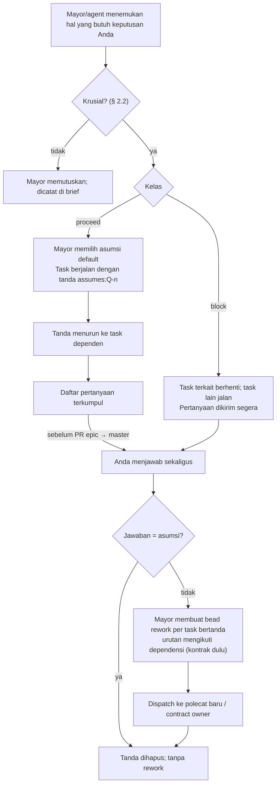

# Re-analisis Revisi 3 — Approval Brief oleh Mayor dan Protokol Pertanyaan + Asumsi

Tanggal: 12 Oktober 2026. Legenda bukti: [V] terverifikasi, [D] dokumentasi resmi, [U] laporan upstream, [I] inferensi, [A] asumsi.

## 1. Keputusan Anda

| Item | Keputusan |
| --- | --- |
| Q12 | Tidak butuh claude.ai connectors/Remote Control. 4a memakai token per proses; 4b memakai home per akun + spike |
| Q11 | **Mayor** menyetujui brief. Mayor mengumpulkan pertanyaan krusial untuk Anda. Pekerjaan yang dibangun di atas asumsi diberi tanda. Setelah Anda menjawab sekaligus, Mayor menugaskan kerja ulang berdasarkan tanda itu |
| Usulan A–E + default pengiriman | Disetujui: klasifikasi `proceed`/`block`, propagasi tanda, aturan merge, lokasi tanda, penugasan rework, pengiriman (c) + (b) |

Dampak: **Gate manusia 1 (approval brief) dihapus.** Penggantinya adalah daftar pertanyaan yang dijawab sekaligus, dan PR epic → master yang diblokir selama masih ada asumsi terbuka. Ini mengoreksi `12` R4 dan D9 di `10` (koreksi K25).

## 2. Protokol

### 2.1 Siklus hidup pertanyaan

### 2.2 Kapan pertanyaan dianggap krusial

Mayor memutuskan sendiri semua hal di luar daftar ini. Keputusannya dicatat di bagian "keputusan" brief.

| Krusial bila menyangkut | Kelas default |
| --- | --- |
| Aturan bisnis yang ambigu atau bertentangan dengan requirement | `proceed` |
| Perilaku yang terlihat pengguna (alur UI, pesan, validasi) | `proceed` |
| Skema DB atau migrasi yang akan di-merge | **`block`** |
| Kontrak API publik atau kontrak lintas-rig yang dipakai banyak task | **`block`** jika konsumen > 1 rig, selain itu `proceed` |
| Auth, RBAC, pembayaran, data pribadi | **`block`** |
| Menghapus atau memigrasi data, operasi yang tidak bisa dibalik | **`block`** |
| Dependensi baru berbayar atau berlisensi tidak standar | **`block`** |
| Keberatan `conflict` reviewer brief yang tersisa setelah 2 ronde | `proceed`, kecuali masuk kategori `block` di atas |

Tabel ini menjadi bagian directives Mayor dan boleh Anda ubah per rig.

### 2.3 Format pertanyaan (satu bead per pertanyaan)

| Field | Isi |
| --- | --- |
| `id` | `Q-<epic>-<n>` |
| `class` | `proceed` \| `block` |
| `question` | Satu kalimat, bisa dijawab tanpa membuka kode |
| `context` | Requirement/AC terkait, dan alasan Mayor tidak bisa memutuskan |
| `options` | 2–4 opsi beserta konsekuensi singkat |
| `assumed` | Opsi yang dipakai sementara (khusus `proceed`) |
| `affected` | Bead yang bertanda, diperbarui otomatis saat tanda menurun |
| `rework_cost` | Perkiraan kasar bila jawaban berbeda: jumlah bead terdampak |

### 2.4 Tanda (marking)

| Lokasi | Bentuk | Fungsi |
| --- | --- | --- |
| Bead | Label `assumes:Q-<epic>-<n>` + catatan asumsi di notes | Sumber kebenaran untuk rework |
| PR/MR | Bagian "Asumsi" di deskripsi | Reviewer tahu bagian mana yang sementara |
| Brief | Bagian "keputusan" mencatat pertanyaan dan asumsi | Konteks untuk agent berikutnya |
| Kode | **Tidak** dipakai | Komentar penanda mudah tertinggal setelah rework |

**Propagasi:** saat task di-dispatch, Mayor (dan nantinya kode) menyalin label `assumes:*` dari semua blocker yang sudah selesai ke task dependen. Contoh: kontrak BE bertanda Q-7, maka bead mobile yang memakai kontrak itu juga bertanda Q-7.

### 2.5 Aturan merge dan selesai

- Task bertanda **boleh** di-merge ke `epic/*`, sehingga paralelisme tetap berjalan.
- PR **epic → master diblokir** selama ada child dengan label `assumes:*` yang pertanyaannya belum terjawab, atau ada bead rework yang belum merged.
- Definisi "selesai" di `10` § 2.6 ditambah satu syarat: tidak ada tanda asumsi yang terbuka.

### 2.6 Pengiriman dan jawaban

- **`block`:** dikirim segera lewat `gt mail send --human` dengan subjek berprefix `[BLOCK]`. Bila tidak dijawab dalam N jam (default 24), Mayor mengirim pengingat.
- **`proceed`:** dikumpulkan dan dikirim sebagai satu daftar paling lambat saat semua child epic merged, yaitu sebelum PR epic → master. Mayor boleh mengirim lebih awal bila `rework_cost` gabungan sudah besar (ambang dikalibrasi setelah pilot).
- **Format jawaban:** satu pesan berisi `Q-id: <opsi atau teks>` per baris. Pertanyaan yang tidak dijawab tetap terbuka. Mayor tidak menafsirkan diam sebagai setuju.

### 2.7 Rework

- Jawaban berbeda dari asumsi: Mayor membuat bead `rework` per bead bertanda (`discovered-from` ke bead asli). Dependensinya disalin, sehingga rework kontrak dikerjakan lebih dulu dan rework konsumen menunggu.
- Konteks rework: bead asli, diff yang sudah merged, asumsi lama, dan jawaban Anda. Polecat asli umumnya sudah tidak ada, jadi rework dikerjakan polecat baru, atau contract owner untuk bagian kontrak.
- Rework melewati gate yang sama (Rank 1 readiness, Rank 2 evidence).

## 3. Risiko approval oleh Mayor dan mitigasinya

| Risiko | Mitigasi |
| --- | --- |
| Mayor menyetujui brief yang ia susun sendiri (bias konfirmasi) [I] | Cek konsistensi mekanis tetap wajib. Review per area konsumen tetap dijalankan oleh leg terpisah. Brief tanpa review tidak boleh disetujui |
| Mayor salah mengklasifikasi hal krusial sebagai keputusan biasa | Tabel § 2.2 di directives; semua keputusan Mayor tercatat di brief sehingga bisa Anda audit sampel; metrik "rework karena keputusan Mayor" |
| Asumsi yang ternyata salah memicu rework berantai | Propagasi tanda membuat dampaknya terlihat (`rework_cost`); kelas `block` untuk area mahal; pengiriman lebih awal bila biaya besar |
| Pertanyaan menumpuk dan tidak dijawab | Epic → master terblokir, sehingga tidak ada asumsi yang lolos ke master; pengingat untuk `block` |

Approval PR child (D3/Q2, default "setiap child selama pilot") **tidak berubah** oleh keputusan ini. Bila Anda ingin approval child juga dihapus, Rank 2 harus sudah `enforce` lebih dulu (D3).

## 4. Pemetaan ke Gas Town

| Kebutuhan | Primitif | Status |
| --- | --- | --- |
| Bead pertanyaan | Bead biasa berlabel `gt:question` (tipe `decision` hanya dirujuk di komentar/test, belum terkonfirmasi sebagai tipe bawaan [V]) | Ada |
| Blokir task untuk `block` | Dependensi `blocks` ke bead pertanyaan; `gt convoy stage` menahan dependen bead `decision`/`gate` yang terbuka [V] | Ada; scheduler fail-closed, feed fail-open (diperbaiki Rank 3K(b)) |
| Kirim ke Anda | `gt mail send --human` [V] | Ada |
| Label + propagasi | Label bd; propagasi otomatis | **Baru** (Rank 3K(g)) |
| Blokir epic → master | Cek label `assumes:*` terbuka | **Baru** (Rank 3K(h)) |
| Rework dari jawaban | Mayor membuat bead dari daftar `affected` | Prosedural (directives/formula); bisa diotomasi kelak |

## 5. Perubahan pada dokumen lain

- `09` Rank 3: scope 3P dan 3K ditambah (§ 4), approval oleh Mayor, AC dan metrik baru.
- `10`: D9, peran Mayor, diagram alur, tabel tahap, penanganan blocked, definisi selesai, titik intervensi manusia, dan event `question.*`.
- `11`: gate Tahap 1, status Q11/Q12, metrik.
- `12`: catatan bahwa R4 (approval oleh Anda) digantikan.

## 6. Koreksi

| No | Klaim sebelumnya | Status | Dasar |
| --- | --- | --- | --- |
| K25 | `12` R4 / `10` D9: Anda meng-approve brief per epic/wave selama pilot | Diganti | Keputusan Anda (Q11): Mayor menyetujui brief. Kontrol manusia dipindah ke daftar pertanyaan krusial + blokir epic → master selama ada asumsi terbuka |
