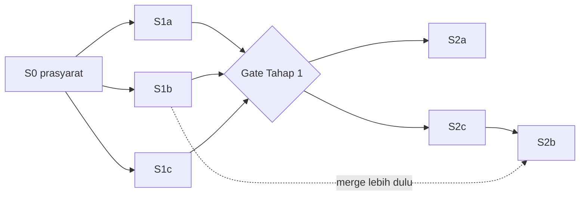

# Spec Eksekusi Enhancement Gas Town

Tanggal: 12 Oktober 2026. Sumber: dokumen analisis `../07`–`../14` (baseline commit `c6d6c55a`).

## Aturan pakai

- **Spec di folder ini adalah keadaan akhir.** Bila ada perbedaan dengan `07`–`14`, spec yang berlaku. Dokumen analisis tetap dipakai sebagai alasan dan bukti, bukan sebagai instruksi.
- **Spec = apa dan kenapa.** Isinya perilaku, acceptance criteria (AC), scope, non-goal, dan rollout. Nama file, fungsi, dan urutan kerja ada di impl plan (`../plan/`).
- Setiap AC punya ID (`S1a-AC3`). Impl plan dan test merujuk ID ini.
- Spec boleh diubah hanya lewat keputusan Anda. Perubahan dicatat di bagian "Riwayat" spec terkait.

## Daftar spec

| ID | Spec | Asal | Tahap | Status |
| --- | --- | --- | --- | --- |
| S0 | [Prasyarat pilot](S0-prasyarat-pilot.md) | `09` § 2 (P0.1–P0.4), D1-B, D2-A | 0 | Sebagian: baseline + upgrade Beads selesai (PR #1); Langkah 3–8 ditahan; butuh Dolt ≥ 2.0.7 |
| S1a | [Kontrak task utuh + readiness](S1a-kontrak-task-readiness.md) | Rank 1 (E04) | 1 | Kode selesai (PR #4) |
| S1b | [State fail-closed di boundary lifecycle](S1b-state-fail-closed.md) | Rank 5 (E16 a–c) | 1 | Kode selesai (PR #2, lanjutan nuke PR #6) |
| S1c | [Koordinasi contract-first prosedural](S1c-koordinasi-prosedural.md) | Rank 3P + protokol `14` | 1 | Aset selesai (`../assets/`); pemasangan + epic pilot menunggu pilot town |
| S2a | [Gate merge berbasis evidence SHA](S2a-gate-evidence.md) | Rank 2 (E05) | 2 | Siap; impl plan ditulis setelah gate Tahap 1 |
| S2b | [Akun Claude bersamaan, satu config](S2b-akun-claude-bersamaan.md) | Rank 4a, invariant I1–I7 | 2 | Bergantung spike SP1 |
| S2c | [Spike E01](S2c-spike-e01.md) | `13` § 8, Rank 4b(a) | 2 (awal) | Siap |

Belum dibuat spec, menunggu hasil tahap sebelumnya: Rank 3K (Tahap 3), Rank 4b (setelah SP2/SP3), enforce kepemilikan (Tahap 4).

## Urutan dan gate

Gate keluar per tahap mengikuti `../11` § 1, dan disalin ke spec masing-masing.

## Keputusan yang mengikat semua spec

| Keputusan | Isi |
| --- | --- |
| D1-B | Pilot memakai DB town baru; backlog per-repo tidak dipindah |
| D2-A | Naikkan Beads di fork; fallback bd terisolasi bila spike > 2 hari |
| D3 | Mode `pr`, approval manusia per PR child selama pilot |
| D6 | Fork produk; patch kecil per enhancement + test; workflow project di overlay/config, invariant di Go |
| D9 (Revisi 3) | Mayor menyetujui brief; pertanyaan krusial + tanda asumsi (`../14`) |
| D10 | Akun Claude bersamaan lewat token per proses; satu `~/.claude` |
| Batas data | Data per-repo existing tidak disentuh tanpa dry-run dan uji restore |

## Status eksekusi (13 Okt 2026)

| PR | Isi |
| --- | --- |
| #1 | Upgrade Beads v1.3.0 (S0) |
| #2 | S1b fail-closed (heartbeat generation, lookup tri-state, guard `gt done`) |
| #3 | Test tidak meninggalkan `dolt sql-server` yatim |
| #4 | S1a kontrak task utuh, readiness, validasi variabel formula |
| #5 | Child epic `parent-child` (bd 1.3) + suite integrasi andal (container Dolt, Ryuk, identity mismatch) |
| #6 | Nuke polecat menolak bila masih memegang pekerjaan / tidak terverifikasi |
| #7 | Suite test hijau di macOS + crash plugin `stuck-agent-dog` |
| #8 | Dokumentasi `docs/enh-masesas/` (spec, plan, baseline, spike, aset S1c) |
| #9 | Test store gagal (bukan skip) bila container Dolt test hidup tapi store tak terjangkau |
| #10 | Test tmux `internal/cmd` memakai socket terisolasi per test; kegagalan `internal/tmux` di bawah beban berat = kehabisan sumber daya, lulus pada beban normal |

Gate Tahap 1 belum ditutup: AC S1c (epic pilot BE + mobile) membutuhkan pilot town (S0 Langkah 3–8, ditahan; Dolt CLI perlu ≥ 2.0.7).
